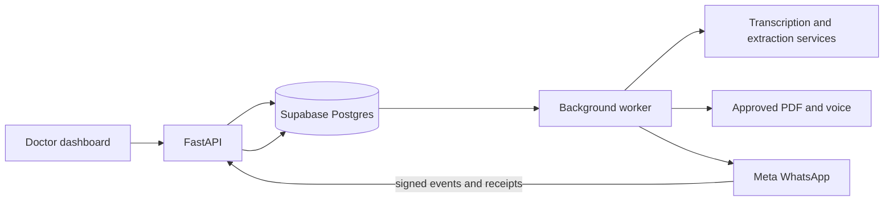

# Dashboard and API reference

This document describes the implementation in this working tree as of 5 November 2026. It covers the private hospital demo, its dashboard, HTTP endpoints, and background processing. It is a technical overview, not a promise of clinical accuracy or production readiness. Some earlier design documents and demo instructions describe an older configuration; the source code is the authority for current behavior.

## System overview

The application is a browser dashboard served by a FastAPI backend. PostgreSQL (Supabase) stores hospital, patient, encounter, report, follow-up, delivery, and audit records. A background worker performs transcription, extraction, report generation, delivery and follow-up processing. The WhatsApp Cloud API receives approved PDFs and sends patient messages and delivery receipts to the signed webhook. Gnani provides transcription and speech; the extraction pipeline uses configured LLM providers. Provider availability and configuration affect which workflows are available.

The hosted deployment uses a container HTTP service and a separate persistent worker on Vercel in Mumbai. The local app may run its worker in process. Source recordings and report artifacts have durable database copies, so hosted API and worker processes do not rely on shared local files. The web interface is primarily `services/api/web/static/app.js`; routes are registered in `services/api/voicerx/app/main.py`, `workspace.py`, `audio_uploads.py`, and `followup_routes.py`.

## Dashboard walkthrough

### Sign-in and hospital workspace

The private landing page accepts the shared demo username and password. The session is server-side; the browser receives a session cookie and CSRF token. An administrator sees **Hospitals**, selects one of the two demo hospitals, and sees that hospital's doctors. The onboarding form records a doctor's name, specialty, and optional registration number. Selecting a doctor changes the workspace context and opens that doctor's patient list. This is a shared demo login and selecting a doctor is an audited workspace action, not individual authentication by that doctor.

### Patient list and registration

The patient sidebar supports search and all/today filters. Registration collects name, assigned doctor, phone with country code, preferred language, birth year, sex, allergy status and known allergies, plus separate AI, recording and WhatsApp consent choices. AI consent is required to register in this demo; recording consent is checked for audio capture, and WhatsApp consent is required for patient delivery. WhatsApp recipients are limited to the configured Meta test numbers. Phone numbers are encrypted in the database, and patient views show only the last four digits. The supported patient languages are English, Hindi, Tamil, Telugu and Gujarati.

Selecting a patient shows their details and visits. A new visit creates an encounter under the selected hospital and clinician. The patient journey includes previous follow-up messages, doctor tasks and uploaded documents as available.

### Capture, processing and review

A visit can take a recorded or uploaded audio file, or typed/pasted consultation text. Audio capture has a consent checkbox and spoken-language choice. Audio is limited to 40 MiB and 20 minutes; hosted chunked uploads use 3 MiB parts. Typed sources are limited to 20,000 characters. A source is saved first; a run then processes the source asynchronously. The UI polls the run for its stage, status and errors and can retry a failed run.

The review screen shows draft report sections, transcript/evidence, problems requiring attention and warnings. The doctor can review evidence, resolve findings, edit or remove lines, and select medicines from the catalog or add a product. A medicine shortlist and reference search assist the clinician; reference search is not itself a patient-specific clinical judgment. Approval uses the current report version and content hash to prevent approval of a stale draft. Blocking issues must be resolved according to the report checks. The approved report is versioned and PDF/artifact generation occurs in the background.

### Approved report and WhatsApp

After approval the dashboard shows available artifacts, the PDF preview/download, delivery status and retry controls where applicable. With configured WhatsApp delivery, patient consent, an allowed phone number and an intact approved synthetic report, the worker queues the PDF to the saved number. A subsequent message offers **Prescription voice** and **Patient menu**. The voice is generated only when requested and uses the approved report's patient language. The PDF and voice jobs are associated with the approved version and recipient; a voice button is checked against the recipient of its source PDF.

Meta's customer-service window applies. A delivery can wait for a fresh inbound message; the current implementation does not configure a business-initiated template. STOP/opt-out prevents further report delivery. The current implementation is a private synthetic/demo workflow: registration and follow-up code mark or gate records as synthetic, and the app should not be treated as a validated clinical system for real patient data.

### Follow-up and next visit

The follow-up view can start an eligible conversation, display messages, simulator controls, patient memory, documents and tasks, and mark a doctor task done. The patient's journey brings forward questions, follow-up interactions and lab uploads for review. Uploaded originals can be downloaded and marked reviewed. Conversation and report-context selection matter when a single test phone is shared across multiple demo patients; the patient menu selects the appropriate report context. Some follow-up operations depend on an approved report, consent, configured services and the synthetic-only gate.

### Navigation

| Browser route | Purpose |
| --- | --- |
| `#/workspace` | Hospitals and doctor onboarding/selection. |
| `#/register` | Register a patient in the current hospital. |
| `#/patients/{patient_id}` | Patient details and visits. |
| `#/encounters/{encounter_id}` | Capture, processing, review, approval and report artifacts. |
| `#/followups` | Doctor follow-up task list. |
| `#/followup/{encounter_id}` | Visit conversation, memory, documents and tasks. |

The hash routes are client-side navigation; dashboard data is retrieved from `/api/v1` endpoints below.

## API conventions and security

The normal API prefix is `/api/v1`; `/whatsapp/webhook` is outside that prefix. JSON is used unless stated otherwise. Except for the login/authentication surface, public landing assets and webhook, dashboard endpoints require a valid session. Mutating dashboard requests use the CSRF token and an allowed Origin; access is further controlled by the current organisation and the session's capabilities (`capture`, `resolve`, `register`) or workspace-admin status. The private production setup disables development login and OpenAPI. Specific route handlers enforce their own checks; do not infer independent per-doctor authentication or row-level isolation merely from the selected doctor in the shared demo.

Application errors generally use `{"error":{"code":"...","message":"...","retryable":false},"correlation_id":"..."}`. Typical statuses include 401 for unauthenticated, 403 for forbidden or CSRF/origin failure, 404 for absent/out-of-scope resources, 409 for state conflicts, 413 for oversize input, 422 for validation or gating, and 429 for rate limits. Framework validation errors can have a different shape. Successful creation is commonly 201; asynchronous run creation is 202. Exact schemas and the complete set of validation rules are defined in the source.

The session cookie is HttpOnly and SameSite=Strict, with Secure enabled in the hosted configuration. Private responses use no-store; security headers, password hashing, login throttling, and audit events are implemented. Credentials and access keys are environment configuration and must never be placed in browser code or this document.

## Endpoint reference

Paths below are relative to the host. IDs are opaque resource identifiers. Request descriptions show important inputs, not exhaustive object schemas.

### Authentication and workspace

| Method and path | Purpose / input / output |
| --- | --- |
| `GET /api/v1/health` | Health response; availability to anonymous callers depends on private deployment middleware. |
| `GET /api/v1/auth/options` | Describes available authentication options. |
| `GET /api/v1/auth/dev-users` | Development users; disabled in private hosted mode. |
| `POST /api/v1/auth/dev-login` | Development sign-in with `user_id`; disabled in private hosted mode. |
| `POST /api/v1/auth/login` | Password sign-in with `username` and `password`; returns session information and CSRF token and sets cookie. |
| `POST /api/v1/auth/logout` | Revoke current session and clear cookie. |
| `GET /api/v1/me` | Current actor, scope, capabilities and workspace status. |
| `GET /api/v1/workspace/hospitals` | Admin: list hospitals accessible to the shared operator. |
| `GET /api/v1/workspace/hospitals/{hospital_id}/doctors` | Admin: hospital information and doctor roster. |
| `POST /api/v1/workspace/hospitals/{hospital_id}/doctors` | Admin: onboard `name`, `specialty`, optional `registration_no`; returns doctor identity. |
| `POST /api/v1/workspace/select` | Admin: select `hospital_id`, optionally `doctor_id`; returns updated session, and hospital selection can include the roster. |

### Patients and visits

| Method and path | Purpose / input / output |
| --- | --- |
| `GET /api/v1/patients` | List patients; optional `q`, `list` (`all` or `today`) and `doctor_id`. Returns `items`, `as_of`, `today`. |
| `POST /api/v1/patients` | Register patient with `name`, `phone`, `language`, `doctor_id`, `birth_year`, `sex`, `allergy_status`, `allergies`, `ai_consent`, `recording_consent`, `whatsapp_consent`. Validates doctor, consent, language and permitted Meta test recipient when WhatsApp consent is enabled. |
| `GET /api/v1/patients/{patient_id}` | Patient summary, consent and visit summaries; phone exposed as on-file/last-four metadata. |
| `GET /api/v1/patients/{patient_id}/samples` | Synthetic evaluation scripts associated with the patient, if any. |
| `POST /api/v1/patients/{patient_id}/encounters` | Capture capability: create a visit, returning encounter ID, date and state. |
| `GET /api/v1/encounters/{encounter_id}` | Encounter, patient summary, latest source and processing run. Audio source can include transcript metadata and audio URL. |
| `GET /api/v1/patients/{patient_id}/journey` | Resolve capability: next-visit history, including follow-up and uploaded report context. |
| `POST /api/v1/patients/{patient_id}/whatsapp-target` | Resolve capability: `phone`, `language`, `consent_confirmed`; checks allowlist and existing contact links. This is the follow-up linking flow, distinct from initial registration. |

### Capture and processing

| Method and path | Purpose / input / output |
| --- | --- |
| `POST /api/v1/encounters/{encounter_id}/sources` | Save typed source: `kind: "typed"`, `language`, `text`; returns source ID and version. |
| `POST /api/v1/encounters/{encounter_id}/sources/audio?language=...` | Save an audio source from raw request body using a supported audio Content-Type and `X-Recording-Consent: patient-agreed` header. |
| `GET /api/v1/encounters/{encounter_id}/sources/{source_id}/audio` | Stream the stored original audio for an authorized visit. |
| `POST /api/v1/encounters/{eid}/audio-uploads` | Start chunked audio: `size`, `media_type`, `language`, `recording_consent: true`. Returns upload ID and `part_bytes` (3 MiB). |
| `PUT /api/v1/audio-uploads/{uid}/parts/{part}` | Upload exact expected raw bytes for zero-based part; upload is scoped to user and hospital and expires. |
| `POST /api/v1/audio-uploads/{uid}/complete` | Assemble and validate all parts; returns the resulting source. Completion is idempotent. |
| `POST /api/v1/encounters/{encounter_id}/runs` | Start asynchronous processing using `source_id` and `source_version`; returns run state and ID, HTTP 202. |
| `GET /api/v1/runs/{run_id}` | Poll state, stage, steps, attempts, errors and resulting draft version. |
| `POST /api/v1/runs/{run_id}/retry` | Retry an eligible failed run. |

### Review, medicines and reports

| Method and path | Purpose / input / output |
| --- | --- |
| `GET /api/v1/encounters/{encounter_id}/report?version=...` | Retrieve a report envelope, checks and metadata; version is optional. |
| `POST /api/v1/encounters/{encounter_id}/resolutions` | Apply review actions to the current report; uses expected version/content hash for concurrency control. See the UI and resolution contracts for supported action payloads. |
| `POST /api/v1/encounters/{encounter_id}/approvals` | Approve with `expected_version` and `expected_content_hash`, provided blocking checks pass; creates an approved version and queues downstream work. |
| `GET /api/v1/encounters/{encounter_id}/artifacts` | List available report artifacts and metadata. |
| `GET /api/v1/artifacts/{artifact_id}/download` | Download an authorized artifact. |
| `GET /api/v1/encounters/{encounter_id}/preview.pdf?version=...` | Render or serve the selected report preview as PDF. |
| `GET /api/v1/encounters/{encounter_id}/clinic-reports` | Return WhatsApp report delivery jobs and statuses for the encounter. |
| `POST /api/v1/encounters/{encounter_id}/clinic-reports/retry` | Retry eligible failed clinic-report delivery jobs. |
| `GET /api/v1/encounters/{encounter_id}/shortlist` | Produce or retrieve the encounter's medicine shortlist for review. |
| `GET /api/v1/catalog/search?q=...` | Search available medicine products. |
| `POST /api/v1/catalog/products` | Add a product using name, form and composition; subject to capability and validation. |
| `POST /api/v1/knowledge/search` | Search reference passages for a question and optional report/medicine scope; results are reference material, not patient-checked clinical advice. |

### Follow-up and uploaded documents

These endpoints require the relevant hospital session and generally the `resolve` capability. Follow-up is gated on the approved report and consent; some paths are synthetic-only.

| Method and path | Purpose / input / output |
| --- | --- |
| `POST /api/v1/encounters/{encounter_id}/followup/consent` | Set `{ "enabled": true/false }` for follow-up consent. |
| `GET /api/v1/encounters/{encounter_id}/followup` | Current conversation and status, or a reason it is unavailable. |
| `POST /api/v1/encounters/{encounter_id}/followup` | Start/initialize eligible follow-up; may return a join command and WhatsApp URL. |
| `POST /api/v1/encounters/{encounter_id}/followup/messages` | Send a simulated reply with exactly one of `text` or `button`. |
| `GET /api/v1/followup/tasks` | List doctor tasks in the current organisation. |
| `POST /api/v1/encounters/{encounter_id}/followup/documents` | Submit raw document bytes with an appropriate Content-Type; maximum 10 MiB. Requires an active follow-up. |
| `GET /api/v1/encounters/{encounter_id}/followup/memory` | Return recent memory items and document summaries. |
| `POST /api/v1/encounters/{encounter_id}/followup/advance` | Advance the demo clock for simulated conversations only. |
| `POST /api/v1/encounters/{encounter_id}/followup/tasks/{task_id}/done` | Mark a task done and audit the action. |
| `GET /api/v1/patient-uploads/{upload_id}/download` | Download original patient-uploaded PDF/image after fingerprint verification. |
| `POST /api/v1/patient-uploads/{upload_id}/review` | Mark an uploaded report reviewed. |

### Meta webhook and application assets

| Method and path | Purpose / input / output |
| --- | --- |
| `GET /whatsapp/webhook` | Meta subscription verification via `hub.mode`, `hub.verify_token`, `hub.challenge`; returns challenge on success. |
| `POST /whatsapp/webhook` | Accept Meta JSON events and receipts after `X-Hub-Signature-256` HMAC verification and business phone ID validation. Body limit is 1 MiB. Returns `{ "ok": true, "queued": n }`; actual handling is asynchronous. |
| `GET /` | Private login or application entry, depending on session and configuration. |
| `GET /v1` | Alternate application entry. |
| `GET /auth-assets/{name}` | Limited login-page assets. |
| `/static/...` | Dashboard static assets; private middleware protects product assets in hosted mode. |

The webhook is intentionally externally reachable but accepts signed Meta POSTs. A successful webhook response confirms acceptance/queueing, not successful message delivery. Delivery states include pending, waiting for the customer-service window or artifact, accepted by Meta, sent, delivered, read, failed and cancelled, depending on job progression. Audit and job records should be checked when troubleshooting.

## Operational notes and limitations

- The deployed app uses a shared private demonstration account, not separate doctor logins; do not treat selection of a doctor as identity verification.
- Only explicitly configured Meta test numbers are eligible in this demo. The patient's saved number and consent determine patient report delivery. A configured phone and valid patient context are necessary but do not override Meta's messaging window.
- Generated findings, translations, prescriptions, document summaries, and speech require clinical review. Extraction, transcription and external services can fail; automatic generation does not guarantee accuracy.
- The backend contains synthetic-only checks for follow-up and report delivery. The demonstration registration path labels records synthetic; that label does not anonymize real data or make the setup suitable for real clinical deployment.
- Vercel API and worker services require runtime configuration and access to Postgres, Meta and configured AI services. Stored secrets and credentials should remain outside the repository.
- For implementation and request details see `services/api/voicerx/app/main.py`, `workspace.py`, `audio_uploads.py`, `followup_routes.py`, `clinic_reports.py`, `worker.py`, `services/api/web/static/app.js`, and `vercel.json`. `docs/PRIVATE_DEMO.md` contains background on the private setup but has an older webhook-routing note; Meta was subsequently switched to the deployed webhook with operator approval.

