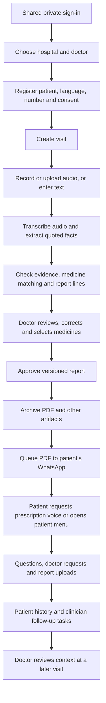
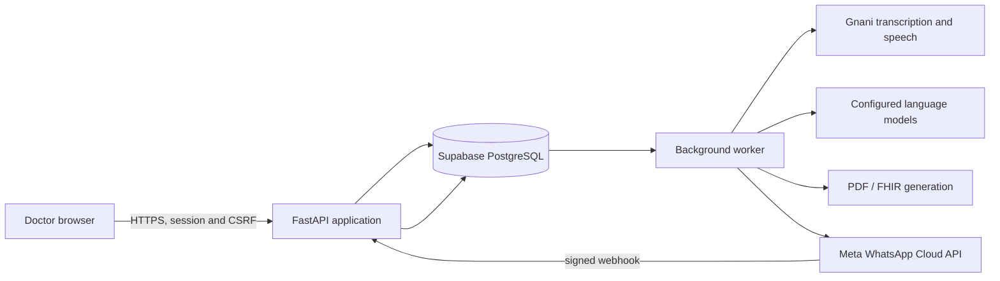

# JANANI / VoiceRx: complete project overview

**Working-tree overview · 5 November 2026**

This document explains the problem the project addresses, what has been built, how the parts work together, what has been tested, and what still needs work. The project is a private demonstration prototype built around synthetic test visits; it is not a certified clinical system. Its working repository name is VoiceRx / `Gnani-Hackathon`.

For screen-by-screen behavior and the complete HTTP route inventory, see [Dashboard and API reference](DASHBOARD_AND_API.md). For older integration details, see [WhatsApp integration](whatsapp-integration.md); where historical notes differ from this document, check current source and deployed configuration.

## 1. The problem

A consultation creates information in several places: what the patient says, the doctor's examination and conclusions, medicine instructions, a printed prescription, later questions, and laboratory reports. If these are kept on paper or in disconnected systems, the doctor may repeat documentation, the patient may misplace instructions or struggle with language, and important follow-up information may not be visible at the next visit.

The project's goal is a connected workflow in which a doctor records or enters the consultation, reviews a structured draft, chooses and checks treatment, approves a digital report, and can later see the patient's questions and uploaded reports. The patient receives the approved report through WhatsApp and can request spoken prescription instructions in their preferred language.

The system assists documentation and communication. The clinician remains responsible for checking the record, selecting medicines and approving the report. Speech recognition, model extraction, translation and generated summaries can all be wrong.

## 2. What has been built

| Need | Implementation | How it helps / limit |
| --- | --- | --- |
| Organize clinics and patient records | Private hospital → onboarded doctor → patient workspace | Operators can add doctors and patients for the two demo hospitals. The login is shared; doctor selection is not individual authentication. |
| Reduce repeat documentation | Audio or typed consultation → transcription → structured draft | The clinician can review a draft instead of starting from a blank report. Accuracy depends on the audio, transcription and models. |
| Make AI output reviewable | Evidence quotations, structured checks, blocking issues, editable report versions | Helps the doctor compare findings to the source and resolve uncertainty; checks do not guarantee correctness. |
| Prescribe and approve | Medicine catalog, matching, shortlist, instructions, review and approval | The doctor selects or confirms treatment. Approval creates a versioned, fingerprinted record. |
| Produce a portable report | Background PDF and FHIR export from approved records | The clinician can access artifacts and the patient can receive a PDF. FHIR output and clinical content are not officially validated. |
| Deliver information to a patient | Meta WhatsApp sends an approved PDF and offers a voice button | The saved patient number and language determine delivery and narration, subject to consent, test-number configuration and messaging windows. |
| Preserve between-visit context | Bot conversation, questions, doctor tasks, memory and lab uploads | The doctor can review the patient's reported concerns and uploaded materials at a later visit. |
| Allow a private remote demo | Vercel HTTPS app and worker, shared login, Supabase, protected API and webhook | Doctors with the demo credentials can access the hosted interface; this is not a complete production security program. |

## 3. End-to-end journey

### 3.1 Hospital, doctor and patient

The private workspace has two demo hospitals, named only in the private `APP_PRIVATE_HOSPITALS` setting. An operator signs in with a shared private account, chooses a hospital and can add doctors by name and specialty, with an optional registration number. Selecting a doctor changes the working context and displays patients assigned to that doctor. Earlier seeded demo organisations were archived; operators add current demo doctors and patients through the interface.

Patient registration captures name, birth year, sex, assigned doctor, phone number with country code, preferred language, allergy status, and separate choices for AI processing, recording and WhatsApp follow-up. AI consent is required by this demo registration flow. Phone numbers are encrypted in the database and the dashboard exposes only their last four digits. For this private Meta test, the number must be among configured test recipients when WhatsApp delivery is enabled. Two recipient numbers have been configured for the current demo; the record's saved number determines that patient's delivery destination.

### 3.2 Consultation capture

The clinician creates a visit and either records/uploads audio or types/pastes text. Recording requires confirmation of patient agreement. The application stores the original audio and tracks the source and its version. The interface accepts up to 40 MiB and 20 minutes of audio; chunked upload divides larger requests into 3 MiB pieces for the hosted environment. These are application limits, not an assurance that every model/provider will successfully process a recording of that length. Typed text has a 20,000-character limit.

The worker uses the configured Gnani Prisma transcription path for audio. The transcript then goes through the same structured extraction and review workflow as typed input. The system processes a completed recording; live drafting during the conversation is not required. Long, mixed-language, noisy, overlapping or unclear consultations still need representative testing, especially for negation, medication names, doses, and who said what.

### 3.3 Extraction, checking and review

The report pipeline is deliberately split into steps:

1. A model extracts clinical facts and medicine mentions with evidence from the consultation text.
2. Code checks the quotations and structured attributes against the source, parses medication instructions where supported, matches products, and records uncertainties and issues.
3. A second model produces structured English report lines linked to extracted item IDs.
4. Further checks compare report statements to their evidence and assemble the draft and medicine table.
5. The dashboard shows evidence, warnings and blocking issues. The clinician reviews, edits or removes items and resolves issues; medicine selection remains under clinician control.

This design makes errors easier to identify and audit, but evidence matching is not a clinical accuracy guarantee. The review screen is an essential part of the current workflow. Model output can fail validation, and an unsuccessful processing run is shown with its stage and a retry option. The clinician must verify clinically important content before approval.

### 3.4 Medicines, approval and exports

The interface supports medicine catalog search, product matching, a shortlist and manual selection. It can record medicine instructions such as dose, schedule, food, route and duration when the supported structured information is present. Unclear or missing information should remain subject to clinician resolution rather than being assumed.

Each correction creates an auditable draft version. Approval checks that the clinician is approving the expected version and content hash and refuses outstanding blocking issues. Once approved, the snapshot becomes the reference for downstream PDF generation and patient communication. Background jobs generate approved artifacts, including PDF and FHIR exports; artifact or delivery failure can be investigated separately from the approval. FHIR and patient-language output still require appropriate validation and clinical/language review.

### 3.5 WhatsApp report and voice

The integrated bot was adapted from the project's WhatsApp bot branch and connected to the same database, approved report records and clinician dashboard. When an eligible synthetic visit is approved, the backend queues its PDF for the patient's encrypted, saved phone number. The worker waits for the PDF to exist, rechecks consent, recipient and report integrity, then sends through Meta. Delivery jobs and provider receipts have distinct states, so acceptance by Meta is not the same as delivery or reading.

A follow-on message provides **Prescription voice** and **Patient menu**. When the patient requests voice, the system uses structured data from the approved report and generates speech using Gnani. The voice option supports English, Hindi, Tamil, Telugu and Gujarati according to the approved report's patient language. Voice is generated on request rather than automatically with every PDF. The voice button is tied to the specific report and recipient.

Meta's customer-service window applies. If a suitable inbound message has not opened the window, delivery can wait; an approved business-initiated template is not configured in this prototype. STOP/opt-out controls prevent continued report messages. Actual delivery depends on provider availability, current Meta settings and the worker running.

### 3.6 Patient questions, tasks and lab reports

The patient's WhatsApp conversation and local simulator support questions and follow-up interactions. The bot can provide information grounded in the approved visit; it can create a doctor task when the patient asks to speak to the clinician or when a workflow requires escalation. Patient statements, questions, answers, tasks and document readings are available in the patient's history for later review. They do not independently change the approved prescription.

For uploaded PDF or image reports, the application stores the original privately, tracks its fingerprint, and can generate a source-linked summary for the doctor. The clinician can download the original and mark it reviewed. If reading fails, the workflow retains the original and supports manual review. The integrated documentation records synthetic and fake-transport tests for uploads; it does not establish that a live patient-uploaded laboratory report has been fully validated end to end.

When a test phone is reused for multiple demo patients, the report-specific **Patient menu** selects the context before subsequent interactions. The product does not silently treat a shared number as proof of a different patient's identity.

## 4. Architecture and data flow

- **Dashboard:** browser JavaScript in `services/api/web/static/app.js`, with private login assets and styling under `services/api/web`.
- **API:** FastAPI application and route modules under `services/api/voicerx/app`. HTTP endpoints, validation and access checks are documented in [Dashboard and API reference](DASHBOARD_AND_API.md).
- **Database:** Supabase PostgreSQL stores organisations, memberships, users, patients, visits, sources, runs, report versions, approvals, delivery jobs, follow-ups, uploads and audit records. Original recordings and approved artifacts have durable database copies.
- **Worker:** processes queued transcription/extraction, PDF and FHIR exports, WhatsApp inbox/outbox and follow-up work. In the hosted setup, the API and worker run separately so processing does not depend on an open browser.
- **Models and speech:** the runtime uses configured providers. Gnani handles the implemented speech paths; extraction providers and fallback behavior depend on configuration. A successful model call is still checked and reviewed.
- **WhatsApp:** Meta posts messages and delivery receipts to the app's signed webhook. The API verifies the signature and business phone ID, persists accepted events, and the worker handles them. The active callback was switched to the deployed app with the operator's approval.
- **Hosting:** Vercel runs the private HTTP container and a separate worker daemon in the Mumbai region. The local server and earlier temporary webhook-only relay were used during development; the production callback no longer depends on that relay.

## 5. Privacy and access measures implemented

The hosted landing page requires a private shared login before showing the dashboard. Sessions are server-side; hosted cookies are HttpOnly, Secure and SameSite=Strict. Mutating dashboard requests use CSRF and Origin checks. Login attempts are throttled, passwords are stored as salted hashes, private responses avoid caching, and security headers are applied. Hosted development login and OpenAPI are disabled.

Patient phone numbers are encrypted; the interface normally exposes only last-four metadata. Contact fingerprints help associate WhatsApp events without routinely exposing numbers. Sensitive environment settings are held outside the source and browser bundle. The public webhook has HMAC verification, a bounded body and business phone ID checks. Access to patient resources is scoped by the session's organisation and checked capabilities, and important actions are audited.

These measures reduce exposure, but a shared account cannot prove which individual doctor acted or support per-doctor revocation. The prototype has not been established as fully secure, compliant, or appropriate for real patient information. Real deployment requires a separate security, privacy and clinical assessment, individual access controls, operational procedures and applicable approvals. A synthetic flag is not anonymization.

## 6. What has been tested and observed

Evidence from project work and recorded checks includes:

- The private dashboard workflow and the hospital/doctor/patient hierarchy were deployed to Vercel and exercised using the shared demo account.
- Earlier integration tests recorded a real-phone synthetic JOIN, language/menu interaction and a doctor callback request that appeared in private Supabase task and memory state.
- An earlier synthetic patient journey sent an approved PDF and a requested Hindi prescription voice note through Meta, with read receipts. A medicine question and its approved-report citation were observed in patient history.
- For the later test report, the PDF arrived. The original voice-button event was rejected by the then-active separate receiver's sender filter. A requested recovery voice was sent and had a read receipt. Both registered test recipients were subsequently configured in the deployed application, the Meta callback was switched to it, and webhook verification, signed transport and rejection of unsigned requests passed. The user later reported that a voice note arrived; the diagnostic query available immediately afterward did not show a new button event, so the specific post-switch tap-to-new-job sequence should be independently rechecked before claiming log-verified end-to-end operation.
- Tests using rollback-only fixtures checked recipient routing for two configured numbers and rejection of a different patient's report voice request. The live registration validation accepted both test numbers without creating records.
- Synthetic/fake-transport tests covered laboratory upload retention and review behavior. They do not substitute for a verified live lab-upload test.
- A previous broad suite recorded 848 passing tests and 3 skipped; later targeted checks were also run. These are historical snapshots, not a claim that every check has been rerun for every current uncommitted change.
- Navigation performance was improved by placing the API near the database, reducing redundant session/roster queries and showing immediate loading feedback. A measured test after changes saw substantially lower request times; real latency varies with traffic, cold starts, network and providers.

## 7. Important current limitations and next work

1. **Clinical accuracy:** transcription and extracted findings may be incorrect or incomplete. Representative multilingual conversation evaluation, independent clinical review and clearly defined accuracy targets are needed. The doctor should review the report, including evidence, before approval.
2. **Real-patient readiness:** the current demo explicitly uses synthetic-only gates and shared credentials. Before real use, address individual accounts, authorization, privacy, consent, clinical validation, operations and applicable legal requirements.
3. **Voice and language:** patient-language speech and translations need independent language and medical review; speech providers can fail or mispronounce terms.
4. **WhatsApp:** only configured Meta test recipients are enabled; production onboarding, approved templates, message-window handling, monitoring and provider policies need further work. A callback is shared by the Meta app and must be coordinated with other developers.
5. **Real-world verification:** repeat a fresh post-switch voice-button test with logs and delivery receipts, test each permitted recipient independently, and verify a real test-phone lab upload with an appropriate synthetic fixture.
6. **Reliability:** external sends and database commits are not one atomic operation, so failure and retry behavior needs monitoring and operational handling. Provider availability, worker capacity and hosting quotas affect delivery.
7. **Data governance:** establish retention, deletion, backup, incident response, key rotation and recovery policies before expanding beyond the private demo. Loss or rotation of encryption/contact-hash keys without a migration plan can affect existing data.
8. **Source and deployment:** the private workspace, deployment and related improvements in the working tree have not all been committed as of this overview. A deployed version and the Git branch can therefore differ; review and commit intentionally before treating Git as the deployment source of truth.

## 8. Where to look in the repository

| Area | Main locations |
| --- | --- |
| Dashboard and endpoint contracts | [DASHBOARD_AND_API.md](DASHBOARD_AND_API.md), `services/api/web/static/app.js`, `services/api/voicerx/app/main.py` |
| Hospital workspace and registration | `services/api/voicerx/app/workspace.py`, `private_access.py`, `migrations/009_private_hospitals.sql` |
| Capture, processing and worker | `services/api/voicerx/app/audio_uploads.py`, `worker.py`, `services/api/voicerx/speech/` |
| Extraction and evidence checks | `services/api/voicerx/pipeline/`, `services/api/voicerx/contracts/` |
| PDF and FHIR | `services/api/voicerx/exports/` |
| WhatsApp and report delivery | `services/api/voicerx/app/followup_routes.py`, `followup.py`, `clinic_reports.py`, `services/api/voicerx/agent/` |
| Patient history | `services/api/voicerx/app/journey.py`, `services/api/voicerx/agent/memory.py` |
| Deployment | `vercel.json`, `Dockerfile.vercel`, `services/api/voicerx/app/hosted.py` |
| Evaluation and tests | `docs/EVALS.md`, `runbook.md`, `services/api/tests/`, `tools/safe_test.py` |

Configuration and credentials are deliberately omitted from this document. Some older documents describe a temporary tunnel, an empty initial roster or the state at the time of a specific test; use them as historical records and verify current runtime settings separately.
