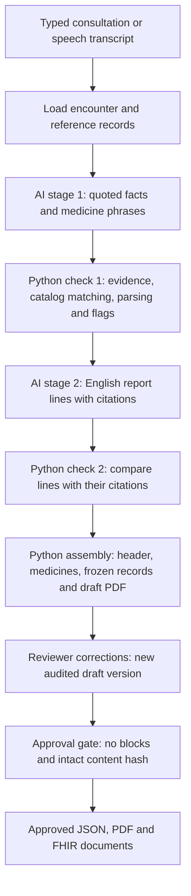

# VoiceRx / JANANI — Detailed implementation and results report

**Snapshot date:** 2 November 2026  
**Project:** `D:\Study\JANANI\Gnani-Hackathon`  
**Scope:** Work completed in the repository and local development environment, including the corpus, audio tools, extraction/report backend, corrections, approval, exports and evaluations.  
**Evidence:** Current source files, saved evaluation JSON, Git history, the implementation plan and the runbook. Generated numerical appendices below identify their source runs.  
**Data boundary:** All project consultations and records are synthetic. Prisma accuracy and keyterm-comparison figures are intentionally excluded from this repository report under the existing project rule.

## Contents

1. Executive assessment
2. Product objective and actual delivery boundary
3. Repository and development environment
4. Data assets and corpus construction
5. Audio generation and speech recognition
6. Complete pipeline and stage responsibilities
7. Data contracts and artifact formats
8. Medicine resolution and instruction parsing
9. Evidence checks and their limits
10. Model providers, prompts and reliability handling
11. Draft assembly, language instructions and PDF rendering
12. Doctor corrections, versioning and approval
13. FHIR export
14. Testing and deliberate sabotage
15. Evaluation methodology and interpretation
16. Results and model comparison
17. Defects discovered and corrections made
18. Worked examples
19. Operational workflow and reproducibility
20. Remaining work and recommended order
21. Source index
22. Generated evidence appendices

## 1. Executive assessment

The project has implemented a working command-line backend that transforms a consultation transcript into an evidence-linked draft outpatient report, supports explicit reviewer corrections, and exports an approved PDF and structured FHIR documents. It also includes the tools and synthetic cases used to develop and evaluate that backend.

The principal design is a two-stage model workflow separated by code checks. The first model extracts clinical facts and medication phrases with source quotations. Python verifies evidence, resolves medicine names against a small catalog and parses instructions into structured values. The second model writes English report sections from the checked clinical facts. Python checks those lines, constructs the medicine table and patient header, and renders the draft. Approval is an explicit separate operation.

The strongest complete recorded typed evaluation uses Groq `openai/gpt-oss-120b` with `extract-v3` and `report-v2`: all 25 cases produced drafts, all 33 expected medicine records were exact on the scorer's five measured medicine fields, and all eight expected flag occurrences were detected. This is a successful development result, not evidence of real-clinic reliability. The same run matched 154 of 173 expected facts, had 20 unmatched extracted facts under the scoring heuristic, and raised eight additional blocking issues. These qualifications matter as much as the medicine result.

The local `qwen3:8b` path also completed all 25 typed cases, but its output imposed substantially more review work: 98 unexpected blocking-issue instances and 55 duplicated extracted items in report sections. It remains a useful offline comparison and fallback, but the measured prototype experience is considerably noisier than Groq's.

The audio workflow is less mature. Twenty-two synthetic clips have Whisper transcripts; three cases lack rendered input. Whisper frequently writes Indian medicine brands in Devanagari while the catalog uses Latin spellings. The current matcher blocks these as unresolved rather than guessing, which protects approval but makes the audio-to-prescription path incomplete. A newer Gnani Prisma script and corresponding pipeline source options are present, with small trial outputs. Their comparative accuracy figures are outside this report's publication scope.

The project is a backend prototype. The doctor-facing web review screen, live microphone experience, database-backed application, patient voice notes and patient calling agent are not delivered by the existing implementation.

## 2. Product objective and actual delivery boundary

The intended product starts with a doctor dictating or conducting a short outpatient consultation in Hinglish or another supported language. It should reduce the work needed to prepare a consultation note and prescription, while ensuring that a person reviews uncertain or conflicting information before it becomes an approved record.

The implemented boundary is narrower and concrete:

| Capability | Current state | Evidence |
|---|---|---|
| Structured synthetic case families and test scripts | Implemented | `data/eval/cases`, `data/eval/scripts` |
| Synthetic audio generation | Implemented; 22 clips recorded in the project inventory | `tools/corpus/render_audio.py`, audio index |
| Local speech-to-text | Implemented with Whisper large-v3 | `tools/corpus/transcribe_audio.py` |
| Gnani Prisma trial transcription | New script and source integration present in working tree | `tools/corpus/transcribe_prisma.py`, runner source options |
| Two model stages with source-linked intermediate JSON | Implemented | `pipeline/extract.py`, `pipeline/write_report.py` |
| Evidence, medicine and report checks | Implemented; lexical/rule based | `pipeline/check_extraction.py`, `pipeline/check_report.py` |
| Draft report, medicine table and patient instructions | Implemented | `pipeline/assemble.py`, exports |
| Explicit corrections and approval | Implemented through CLI | `resolve.py`, `approve.py` |
| Approved PDF and FHIR documents | Implemented; official FHIR validation pending | `exports/pdf`, `exports/fhir.py` |
| Model comparison and scorer | Implemented | `tools/eval/score_report.py` |
| Web application, persistent database and job system | Scaffold folders only | `apps/web`, `db`, `jobs`, migrations |
| Patient voice agent and voice-note delivery | Future work | Agent package is a scaffold |

“Implemented” here refers to source code and the available tests/artifacts. It does not imply clinical review, production deployment, external certification or complete user-interface integration.

## 3. Repository and development environment

The shared workspace separates source, downloaded reference material, model weights and the Python environment:

```text
D:\Study\JANANI\
  .venv\                  Python environment
  DATA\                   Downloaded third-party reference packages
  models\                 Whisper weights and Ollama model storage
  Gnani-Hackathon\         Git repository
    services/api/voicerx/  Processing backend
    services/api/tests/   Backend unit and integration tests
    tools/corpus/         Case, formulary, audio and transcription tools
    tools/eval/           Offline scorer and scorer tests
    data/                 Synthetic source data and selected score summaries
    runs/                 Ignored generated artifacts and model response cache
    docs/                 Design, plan, decisions and reports
    graphify-out/         Ignored code knowledge graph
```

The backend uses Python 3.12. Its declared dependencies include Pydantic 2, PyYAML, Jinja2, RapidFuzz, pypdf and pytest. Audio work additionally uses faster-whisper, PyAV and NVIDIA GPU libraries. Edge or Chromium prints HTML to PDF. Ollama serves the local language model.

Implementation work is on `aditya/extraction-report`. The source review leading to this report found additional uncommitted changes around Prisma source support, its transcription script, scorer source selection, associated runner tests and ignore rules. The generated snapshot appendix records the actual Git base and working-tree status at report-build time. Existing edits are treated as part of the inspected working copy, not silently attributed to the last commit.

The repository also has a code knowledge graph, queried during the inspection to identify relationships among extraction, checking, assembly, correction, approval and export. Source files and saved run artifacts remain the authority for implementation details and measured results; a graph is a navigation aid.

## 4. Data assets and corpus construction

### 4.1 Why the project built its own cases

The project needed small, controlled examples combining Indian medicine brands, code-mixed dictation, missing information, corrections and matched clinical variations. The repository's data method therefore uses project-authored synthetic cases rather than treating a large downloaded conversation dataset as ready-made gold.

The corpus has 12 families and 25 variants. Eleven families have two alternative variants; the longitudinal family has three successive visits. Family membership is meaningful: alternate versions of one encounter must not become each other's clinical history, while successive visits can carry medication state forward.

Languages at family level are seven Hinglish, two English, one Hindi, one Tamil and one Telugu. Two families are orthopaedic; the others are general medicine. All cases are development cases, not an independently held-out evaluation set. Clinical and native-language review remain pending. The generated family inventory later in this report lists each family's scenario tags.

### 4.2 What a case contains

Each YAML family records a synthetic patient, language, specialty, encounter dates, doctor identifiers, structured expected facts and medications, alternative utterances, evidence quotations, corrections, traps, withheld information and expected flags. Some families also define medication timelines and patient-agent questions.

Facts distinguish present, absent and unknown assertions; current, past and planned timing; stated, provisional and rule-out certainty; patient versus family subject; and left, right or bilateral side. These distinctions were deliberately made machine-readable so a report can be evaluated for more than superficial wording.

Variant overrides change only selected expected fields. For example, one variant denies fever while another reports it; one says a bare ambiguous medicine brand while another states its strength. Such pairs expose whether the pipeline reacts to the changed evidence.

The runtime runner reads the consultation text and encounter metadata, not the expected clinical answers. The offline scorer reads expected answers separately. This separation is central: the report being scored cannot also serve as its own gold answer.

### 4.3 Seed records, reference catalog and rules

The project has one synthetic clinic, three doctors and 30 patient seed records. Patient data supplies identity, birth year, language preference and recorded allergy status. Age is calculated from birth year and visit year and displayed as approximate.

The starter formulary contains 25 products. Its rows distinguish brand, manufacturer, form, release type, ingredient components, strength units and aliases. The rows remain unverified. The allergy-class table is also explicitly unreviewed. The fact that a rule runs successfully does not validate the clinical contents of the underlying table.

Unknown allergy status is distinct from no known allergies. Product strength is distinct from the amount taken at a time. These distinctions carry through contracts, report headers and medicine instructions.

### 4.4 Downloaded reference material

The download inventory records seven reference groups: an Indian medicine dataset, Indian drug MCQA material, a Jan Aushadhi export, NLEM 2022, RIRS_NOISES, the ABDM implementation-guide package and examples, and optional ACI-Bench material. They are stored outside the Git repository. The inventory records versions, checksums and usage restrictions.

These downloads are ingredients and references, not proof that every source is used in the current runtime. The runtime reads the curated 25-row formulary and project seed/rule files. RIRS_NOISES is available for future noisy variants; its presence does not mean those variants have been evaluated. ACI-Bench remains an optional outside comparison. The downloaded medicine dataset's side-effect and interaction prose is excluded from patient drug-card use because its provenance is not established in the project inventory.

### 4.5 Corpus validation already built

`check_cases.py` validates consistency between cases, evidence, utterances and expected records and can regenerate the plain scripts and manifest. Earlier runbook checkpoints record deliberate case corruption checks, invented-number and invented-medicine checks across families, and tests that disable individual checker rules. These are validation results for synthetic corpus consistency; they do not establish that treatment content is clinically appropriate.

## 5. Audio generation and speech recognition

### 5.1 Synthetic audio generation

`render_audio.py` reads case utterances and requests audio from Gemini's speech models. The configured render list includes `gemini-3.8-flash-tts` and `gemini-3.8-flash-lite-tts`. Doctor identities map to selected synthetic voices, and a separate patient voice supports interruption examples.

The tool keeps completed clips, retries transient failures, distinguishes daily quota exhaustion and writes an index with audio source, model, voice, format, duration and hashes. This makes it possible to trace a transcript back to a particular generated recording rather than assuming all clips came from the same voice/model configuration.

The project inventory records 22 rendered clips: 11 from each of the two TTS models. Three intended cases remain missing. Although 16 kHz was requested, an early response was 24 kHz, so audio consumers must inspect/resample the actual recording rather than trust the requested rate.

### 5.2 Local Whisper transcription

`transcribe_audio.py` loads Whisper large-v3 using faster-whisper, with CUDA and `int8_float16`. The local model directory is under the workspace's `models` folder. CUDA library directories are added to the Windows path before loading the model.

A significant defect was discovered during audio testing: long Devanagari decodes reached Whisper's token cap and silently dropped later speech. The fix was to transcribe speech in chunks of at most ten seconds, decode the chunks separately and join their text. The script also marks suspicious truncation, including broken characters or chunks close to the token cap.

The runbook records 22 clips transcribed after this change, with no truncation flags in that inventory and 1,223 transcript words against 1,250 script words. Word counts are a coarse completeness signal, not a formal speech-recognition accuracy score. They cannot establish whether a crucial word such as a negation survived.

A recorded repeat-run timing on a 21.9-second clip was eight seconds on GPU versus 80.1 seconds on CPU. This is a historical single-clip measurement, affected by warm-up and hardware, and must not be treated as a batch latency guarantee.

### 5.3 Gnani Prisma trial path

The newer `transcribe_prisma.py` sends WAV audio to the configured Prisma v3.0 REST path. It resamples recordings to 16 kHz mono PCM, supplies language codes and a chosen text format, and optionally supplies up to 200 brand/alias hints drawn from the formulary. Hints come from the catalog, not per-case expected answers.

The script's current REST handling skips clips longer than its 30-second limit rather than splitting them. It saves transcripts and a summary under ignored `prisma` or `prisma-keyterms` result directories. Both source names are accepted by the current working-copy pipeline and scorer. Small trial outputs exist in both variants.

This is a batch experiment path. It is not a completed live microphone, realtime diarization or browser consultation interface. Prisma transcript content and accuracy/keyterm-comparison figures are deliberately not reproduced here, consistent with the repository's publication rule.

## 6. Complete pipeline and stage responsibilities



### 6.1 Input loading

The runner constructs a `CaseInput` with case/family identifiers, encounter order, transcript, patient and doctor IDs, visit date and language. Typed input joins the utterances' text without adding speaker labels. Speech input reads a transcript text file from the chosen source directory. A missing file becomes a missing input, not an empty consultation or a silently skipped case.

### 6.2 Stage 1: extraction

The model receives the transcript, delimited as untrusted data, and formulary brand spellings for context. It returns individual clinical facts and medication mentions in the `Extraction` schema. Each fact includes an English term and a source quotation in the original script. Each medicine has a quoted name and separate quoted dose, timing, food, duration, start and route phrases.

The prompt explicitly forbids guessing absent details, translating evidence quotations, using a frequency as a quantity, inventing a side from a plural body part or using catalog context as evidence that a medicine was prescribed. A taper is represented by its whole ordered instruction in the timing phrase so its sequence can be parsed by code.

### 6.3 Check 1: evidence and interpretation

Python compares quotations with normalized transcript text, preserves mention boundaries, checks assertions and side/uncertainty cues, and determines how much of a medicine mention can be safely parsed. Unsupported medicine phrases are flagged and excluded from parsed values. It then resolves products, parses instructions and raises missing-quantity, ambiguous-product, unmatched-product and allergy-conflict issues where applicable.

The output preserves both the kept evidence and review problems. Not every failed check drops an item: many errors remain visible in the draft and block approval so the reviewer can correct them.

### 6.4 Stage 2: report writing

The second model receives the checked clinical items' IDs, kinds, English terms and structured attributes. It does not receive the original transcript, original quotations or responsibility for building the medicine table. It writes eleven possible English report sections, with each line citing one or more item IDs.

The prompt requires use of each item, one fact per line, explicit negation for absent findings, preservation of uncertainty and subject, and separation of tests ordered from results already available. Empty sections are returned as empty lists.

### 6.5 Check 2 and assembly

Python validates citations and checks textual markers for changed numbers, medicine/dose content introduced into narrative sections, lost negation, mixed assertions, wrong subject, altered certainty, side changes, missing findings and duplicate use. Wrong section placement is visible as a warning. The checks are conservative rules, not a full language-understanding verifier.

Code then builds the header, current medicine list, medicine rows, explicit missing-information wording, omitted-section list and issue list. It freezes the patient, doctor, clinic and relevant product records and calculates the content fingerprint. A draft PDF is rendered where a browser is available.

## 7. Data contracts and artifact formats

Pydantic contracts provide a shared typed boundary for provider responses and internal records. Unexpected fields are forbidden in the strict contracts. Extraction requires unique IDs across facts and medicines. Doses use positive numeric strings so decimal quantities are not casually converted into imprecise or ambiguous representations. Zero dose is invalid; missing dose is `null`.

Core contracts include `ExtractedItem`, `ExtractedMedication`, `ExtractedCorrection`, `Extraction`, `ResolvedMedication`, `CheckedExtraction`, `ReportLine`, `ReportFields`, `DraftReport`, `Resolution`, `ApprovedReport` and `Issue`.

| Artifact | Purpose |
|---|---|
| `transcript.txt` | The actual text processed by this run |
| `extraction.json` | Validated stage-1 model response |
| `checked_extraction.json` | Evidence kept/dropped, parsed medicines, corrections and issues |
| `report_fields.json` | Stage-2 narrative lines and citations |
| `draft_report.json` | Complete current draft, frozen references, issues, version and hash |
| `report.pdf` | Human-readable draft with synthetic label and draft watermark |
| `meta.json` | Transcript hash and per-stage provider/model/prompt/cache metadata |
| `status.json` | Draft, incomplete-at-stage or missing-input outcome |
| `draft_report.v<N>.json` | Earlier corrected draft preserved by version |
| `approved_report.json` | Approved record with approver and timestamp |
| `report_approved.pdf` | Approved human-readable output |
| `fhir_op_consult.json` | Structured consultation document |
| `fhir_prescription.json` | Structured prescription document where applicable |
| `fhir_status.json` | Explicit official-validation status |

Stage files are diagnostic artifacts as well as outputs. A reviewer can distinguish an extraction problem from report-writing or rendering failure instead of investigating only a final PDF.

## 8. Medicine resolution and instruction parsing

### 8.1 Product matching

The matcher normalizes number words, separates numeric/name tokens and compares catalog brands and aliases using whole tokens. This avoids matching `5` inside `2.5` or discarding meaningful suffixes such as combination-product names. Candidate scoring distinguishes closer token agreement from weaker compatibility. The output is exact, ambiguous or unmatched, with candidate IDs where available.

RapidFuzz supplies spelling similarity for candidate discovery. A fuzzy suggestion never silently becomes an exact prescription. Historical current-medicine IDs can help disambiguate a compatible known product, but history is not manufactured between alternative variants.

Grounding checks also compare the model's name with its quoted evidence. Subsequent fixes allow a genuine verbatim name to resolve an overly padded quotation while preserving the rule that a short ambiguous brand quote must not invent a strength. Conflicting names and unsupported strengths remain review problems.

### 8.2 Parsing medication instructions

Python handles number words and supported phrase patterns rather than asking a model to supply normalized dose slots. Supported structures include positive doses, durations in days/weeks/months, daily frequencies, explicit morning/afternoon/evening/night grids, as-needed instructions with an explicit maximum where stated, taper steps and supported start-date phrases.

“Twice daily” is a frequency, not an instruction to take medicine in the morning and at night. Slots are populated only when a time is explicit. A taper preserves each step's dose, duration and time-of-day grid. A maximum such as “not more than four” is retained rather than being mistaken for a correction and removed.

Unknown phrases remain unresolved with visible warnings. The parser has a defined phrase vocabulary; it is not a universal interpreter of every possible Indian-language instruction.

### 8.3 Medication actions and longitudinal state

Actions distinguish start, continue, change, stop and history. Start/change/continue medicines populate the instruction table. Continue/history/stop also inform the separate current/past/stopped display.

Medication state chains between visits only when the preceding encounter has a single unambiguous variant. Alternative variants a/b of the same visit never chain. If a preceding visit is incomplete, the next runs without fabricated history and receives a warning. Product IDs with unresolved matching, unbound phrases or unclear speakers do not update the active-state calculation.

### 8.4 Important boundaries of the rule set

The implemented allergy check compares catalog ingredients against the patient's recorded allergies and the project class table. It is not a comprehensive interaction checker, contraindication engine, dose-range validator or treatment recommender. Those capabilities must not be implied by a successful allergy-conflict test.

## 9. Evidence checks and their limits

Several fixes strengthened the distinction between genuine evidence and plausible-looking output:

| Check area | Implemented protection | Remaining interpretation limit |
|---|---|---|
| Source quotations | Case, whitespace and Unicode normalization; presence checks | A quotation's presence does not prove the English term faithfully translates it |
| Indian-script word boundaries | Combining marks treated as part of words | Cue lists remain finite |
| Medicine phrase ownership | Boundaries at sentence marks, line breaks, next medicine and mention window | Complicated discourse and corrections can require review |
| Negation and unknown status | Explicit checks for absent/unknown wording | Scope of negation is not fully semantically parsed |
| Side | Supported side words required; invented sides flagged | Nonstandard descriptions may not be recognized |
| Certainty | Provisional/rule-out distinctions and hedged-source checks | All subtle hedges are not guaranteed detectable |
| Subject | Family-relative markers checked | Pronoun resolution is limited |
| Speaker | Patient/unclear medication handling and first-person heuristics | Doctor first-person dictation can create conservative extra blocks |
| Report citations | Known source IDs required | Valid IDs alone do not prove sentence entailment |
| Omissions/duplicates | Uncited or repeatedly cited kept facts counted | Facts missed by stage 1 are outside the stage-2 omission denominator |

These limits are material. The implementation reduces several demonstrated failure modes and makes review work explicit; it cannot be described as proving that all accepted statements are clinically true. A doctor's approval is a recorded review decision, not an automated certification of care.

## 10. Model providers, prompts and reliability handling

### 10.1 Provider evolution

The design initially used Gemini. Mistral was explored and dropped after account/key failures recorded in the runbook. Ollama was added as a local fallback. Gemini's long delays and overload/quota interruptions then motivated the Groq adapter. The successful completed comparison uses Groq and the local model on the same current prompt versions.

The current default client construction order is Gemini, then Groq, then Ollama, for configured providers. Explicit `--provider` selection supports controlled single-provider evaluations. Calling Groq the working evaluated model does not mean the default order has been changed to Groq first.

| Provider | Configured model/path | Role |
|---|---|---|
| Gemini | `gemini-3.8-flash`, Interactions API | Hosted option; full comparable final result unavailable in the reviewed score set |
| Groq | `openai/gpt-oss-120b`, OpenAI-compatible structured chat | Best complete measured typed result |
| Ollama | `qwen3:8b`, local chat endpoint | Offline-capable comparison/fallback |

No model was trained or fine-tuned by this project. Work consists of prompting, schema constraints, deterministic interpretation, checks, review controls and evaluation.

### 10.2 Prompt versions

`extract-v1` was the original extraction prompt. `extract-v2` made the side rule explicit: plural body parts do not establish bilateral findings. `extract-v3` further separates strength/name, per-dose quantity, timing and food phrases, and insists that evidence remain in its original script. `report-v2` tightens certainty behavior, including avoiding an invented provisional label merely because a doctor said “Impression.”

Prompt versions are recorded per stage. Comparing outputs generated under different versions without labeling that difference would confuse prompt improvement with model quality. Earlier runs are retained as history but separated from the final comparison.

### 10.3 Validation, retries and cache

The client derives a strict JSON schema from Pydantic, expands references and rejects invalid provider responses. Invalid output gets one repair attempt. A second invalid response marks the case incomplete; it is not converted into an empty successful report.

Transient HTTP failures, including timeouts mapped to retryable responses, use bounded retries with provider Retry-After information or backoff. Quota exhaustion can move to the next configured key/provider. A truly unavailable local server does not get treated as a valid empty response. Invalid model output is a different failure from quota exhaustion and is not silently relabeled as provider availability.

Successful responses are cached by provider, model, prompt version, system prompt and user input. Cache contents are revalidated on read. Atomic replacement, unique temporary files and synchronization protect cache writes when independent families overlap. This also lets deterministic fixes rebuild drafts from earlier model responses without claiming new inference was performed.

Secrets are read from ignored configuration and sent in provider headers. Error reporting is sanitized. Per-stage metadata records a key index, not the credential value. Cache reuse is recorded; cached calls must not be presented as fresh latency measurements.

### 10.4 Local resources and concurrency

Ollama uses an 8,192-token context with thinking disabled and a 4,096-token output cap. Cut-off or context-overflow responses are rejected. These settings were introduced after a local output loop demonstrated that unbounded generation could stall the run.

The runner permits one to four independent families in flight, defaulting to one. Visits within a family remain ordered. Local-model calls are serialized for the shared laptop GPU. This is execution concurrency, not multiple independent agents implementing the project.

## 11. Draft assembly, language instructions and PDF rendering

Python assembles the final draft from validated structures. Catalog ingredients and strengths produce medicine labels; the model is not allowed to supply those labels as authoritative pharmacological data. Explicitly unstated dose, timing, food, duration and start information remains visible rather than filled with a conventional default.

The draft stores a deep-frozen copy of the patient, doctor, clinic and products used, including relevant candidate products. Its canonical JSON content receives a SHA-256 fingerprint. This makes the reviewed content reproducible even if live reference data later changes.

The language instruction box uses fixed Hindi, Telugu and Tamil YAML templates. It formats the same parsed quantities and schedules used by the English record. Unknown instructions ask the doctor, and unresolved medicines remain identified rather than disappearing into an anonymous warning. English preferences do not get a redundant translation box. Translation review status and the official-English-record notice are displayed.

Jinja2 autoescapes record and model text into HTML. Edge/Chromium prints A4 PDFs with a synthetic-data label, structured report sections, four medicine timing columns, review issues, version/hash footer and draft watermark. Approved output removes the draft watermark and prints approval information in IST.

Layout work included correcting footer overlap, using page-margin footers, escaping footer content and preserving readable spacing. A later user decision explicitly allowed two pages; fitting everything on one page is not a requirement. Whole sections and medicine rows are kept together where possible.

The renderer has a bounded browser wait and kills the browser process tree on timeout. A stalled render must not hold captured output pipes indefinitely or leave a report that appears successfully current.

## 12. Doctor corrections, versioning and approval

Corrections operate on an intact draft through explicit `Resolution` records containing ID, action, target, value, reason, author and timestamp. Each accepted correction operation produces a new draft version, links to the predecessor hash and retains the correction history.

Available actions cover choosing a catalog product, setting dose/timing/food/duration, removing a medicine, confirming an unclear order, editing/removing/adding report lines, dismissing a finding no retained line uses and acknowledging an existing nonblocking warning. A blocker cannot simply be acknowledged away as if it were a warning.

Report-line correction was added after early use showed a real workflow gap: medicine-only corrections could not clear blocked diagnoses, side errors or omissions. Adding a line or explicitly dismissing an unused finding gives a reviewer a way to resolve a stage-2 omission rather than leaving the draft permanently unapprovable. Flag targets are renumbered when lines move after removal.

Approval requires a draft, a nonblank approver, zero blocking issues and a matching content fingerprint. Reapproval validates the current draft before it considers reusing earlier approval metadata. This closes a defect in which an old approval could otherwise bypass validation of later changes.

The approval identity is currently supplied by CLI text. Authentication, professional identity verification, access control and a true digital-signature infrastructure are outside the delivered backend. A content hash detects unintended content changes relative to the stored hash; it is not itself proof of who reviewed the record.

Signed/versioned artifacts survive reruns and different approvals by being moved into timestamped `superseded-...` directories. This replaces the earlier behavior that could delete or overwrite reviewed work while trying to avoid stale outputs. Source inspection confirms this preservation logic; the historical worked approval is documented in the runbook, while a current top-level signed sample was not found in the inspected case directories.

## 13. FHIR export

`build_bundles` accepts only an approved record with a valid fingerprint. It builds documents from the frozen references rather than rereading current patient/catalog records. The implementation uses FHIR R4 and codes/profiles pinned to the downloaded ABDM examples.

| Report concept | Resource or representation |
|---|---|
| Patient | Patient |
| Doctor | Practitioner |
| Clinic | Organization |
| Visit | Encounter |
| Diagnosis | Condition with certainty-related verification status |
| Known recorded allergy | AllergyIntolerance |
| Exam, vital or available result | Observation |
| Test order or referral | ServiceRequest |
| Current/past/stopped medicine | MedicationStatement |
| Prescription order | MedicationRequest |
| Negative findings and report narrative | Composition narrative; not positive clinical resources |

Document bundles start with a Composition and use deterministic UUID-based references. A consultation document is produced, and a prescription document where medicines are present. Review fixes reduced the prescription bundle's contents so unrelated consultation observations are not carried into it.

Frequency, explicit time slots, as-needed use and taper steps are represented from the structured medication record. Tapers retain sequence, dose and step duration. The frozen display label supplies medication text. A MedicationRequest's narrative detail is still important: not every instruction dimension is encoded into a specialized machine-readable field.

The official HL7 validator has not been run as part of this delivery. Export status explicitly says “not officially validated.” Comparison with example shapes and internal reference-resolution tests are valuable but do not establish full ABDM conformance or successful hospital-system interoperability.

## 14. Testing and deliberate sabotage

The implementation plan called for test-first tasks followed by the whole relevant suite before task commits. The history records the original 128 corpus/audio tests and successive backend additions, including contracts, parsers, matching, both model-stage prompts, both checks, assembly, correction, approval, language templates, PDF, FHIR, runner and scorer tests.

Model-client tests use fake responses to exercise schemas, cache behavior, retries, key/provider fallback, truncated output, one-repair behavior and errors without spending live requests. The cached end-to-end test uses hand-written `fam-001-a` responses so routine tests do not call a model.

The planned sabotage suite deliberately changes ten aspects of that cached run: removes negation from a quote, removes negation from report writing, changes a dose, changes strength/name, borrows duration from another sentence, attributes a relative's finding to the patient, makes a provisional diagnosis definite, mixes absent and present facts, makes the medicine speaker unclear and writes a new medicine as an existing current medicine. Each has an expected blocking code.

Additional regressions cover Hindi combining marks, newline dose borrowing, conflicting quoted/normalized medicine identities, unsupported inferred strengths/sides, unknown assertions, reapproval tampering, concurrent cache writes, ordered family histories, timeout behavior, preservation of reviewed artifacts, line edits and omissions, as-needed maximums and PDF/FHIR review findings.

The runbook's last completed branch review records 372 passing tests. A fresh whole-suite run was started specifically for this report; its separately recorded outcome appears in the snapshot appendix. This avoids presenting an older number as fresh validation of newly edited files.

Automated tests protect demonstrated behaviors. They do not replace clinical and language review, and a passing suite does not measure generalization beyond the cases or phrase patterns covered.

## 15. Evaluation methodology and interpretation

### 15.1 Typed versus transcribed inputs

Typed runs isolate extraction/report behavior from speech-recognition changes. Speech runs introduce an additional upstream error source and script/spelling differences. Their results are kept separate. The scorer marks non-typed results approximate; they must not be blended into one headline accuracy number.

### 15.2 Matching facts

For typed input, a kept item's quote can match an expected evidence quote when its tokens cover at least 60% of the expected quote's tokens. Matching is greedy, ordered by match strength, and one-to-one. For speech input, the scorer uses token-set similarity of extracted English terms and expected text at a threshold of 70. These are evaluation heuristics, not human adjudication.

### 15.3 Exact meaning of the measured fields

| Metric | What the scorer counts | What it does not establish |
|---|---|---|
| Facts found/missed | Expected spoken facts paired/not paired with kept items | Perfect semantic translation or full factual correctness |
| False facts | Extracted kept items left unmatched by the heuristic | Every unmatched item is a fabricated clinical claim |
| Negation accuracy | Equality of assertion on matched fact pairs | Correct negation for unmatched/missed facts |
| Side accuracy | Equality of laterality on matched pairs, including null/null | Performance only on side-bearing findings |
| Medicines exact | Paired medicine agrees on product, dose, schedule, food and duration | Correct action, route, start date or every prescription field |
| Extra medicines | Extracted medicine mentions not paired to expected ones | Every unmatched mention is genuinely newly invented, especially across scripts |
| Expected flags | Expected distinct flag codes present per case | All errors detected, or all correct target-specific flags |
| Section accuracy | A paired item is cited in its expected section | Quality of all report prose |
| Report omissions | Kept extracted items never cited | Facts stage 1 failed to extract |
| Report duplications | Kept items cited more than once | All types of repeated prose |
| Unsupported lines | Missing citations or citations to unknown kept IDs | Semantic entailment, medical correctness or no hallucinations |
| Unexpected blocking flags | Blocking instances whose code is not in that case's expected-code list | Automatically a checker defect; many are rightly caught model errors |

The distinction between stage-1 recall and stage-2 omission is especially important. Groq can have zero report omissions while still missing 19 expected facts: it wrote all the facts it retained, but extraction did not retain all expected facts.

Similarly, 33/33 exact medicine records is an exact result within the scorer's named five-field definition. It must not be expanded into “all prescription dimensions clinically validated.”

### 15.4 Coverage and version handling

Missing-input and incomplete cases are listed explicitly. Metric denominators apply to scored cases, so different coverage can change a denominator without any underlying accuracy improvement. Score files record run identity, source, per-case metrics and model metadata. Where a doctor-corrected draft has an archived v1, the scorer uses that original machine output rather than awarding the model credit for the doctor's correction.

The final typed comparison uses the same `extract-v3`/`report-v2` prompt pair, but is still a development-set comparison rather than a randomized controlled benchmark. Reference/checker fixes and cache-based rebuilding also affect historical comparisons. These details are part of the result, not incidental implementation history.

## 16. Results and model comparison

### 16.1 Final typed comparison

Groq produced drafts for all 25 cases. Its 154/173 fact match count is approximately 89.0% under the typed matching rule. Its section accuracy is 133/154, approximately 86.4% on matched pairs. Assertion and side equality were 152/154 and 153/154 respectively. It produced no extra paired-unmatched medicine mentions in the recorded final typed comparison and achieved 33/33 exact medicines on the five measured fields.

The local model also produced 25 drafts. Fact matching was 148/173, approximately 85.5%; exact medicines were 21/33, approximately 63.6%; expected flags were 8/8. Its greater duplication and block counts are important usability evidence: a model can finish every case yet still demand substantially more reviewer effort.

The full numerical table in the generated appendix includes counts and denominators for every saved metric. Percentage descriptions here are derived for readability and do not replace the counts.

### 16.2 Model errors caught in final typed output

The runbook categorizes Groq's eight unexpected blocks as two unsupported-side quotations, two hedged diagnoses recorded as stated, three negation problems and one quote spanning two clauses. They are primarily examples of the checks doing useful work, not proof the model's prose was ready to sign.

Local output has 98 unexpected block instances in the final score file, including substantial certainty, omission and phrase-grounding burden. The appendix gives the actual per-case flag-code counts from the saved summaries. Earlier runbook descriptions with 97 instances or 20/33 local medicines are intermediate checkpoints, superseded by the final score file's 98 and 21/33.

### 16.3 Whisper comparisons

Whisper/Groq has 21 scored drafts, one incomplete case and three missing inputs. It matched 121/147 expected facts among those scored cases, but only 5/26 medicine records were exact. Whisper/local has 22 scored drafts and three missing inputs; it matched 69/154 facts and 3/29 exact medicine records.

The missing cases are `fam-011-v3`, `fam-012-a` and `fam-012-b`. The Groq incomplete case is `fam-010-a`, recorded as invalid model output after its repair opportunity. These cases remain visible in coverage instead of vanishing from the headline result.

The medicine failure pattern is strongly associated with script mismatch. The runbook records many transcribed brand names in Devanagari and a Latin-only alias catalog. For example, a spoken brand corresponding to Dolo may arrive as `डोलो 650`; an otherwise meaningful extraction remains unmatched by the catalog path. This also explains why the expected ambiguous-product flag on bare Pan can become an unmatched-product block instead. Blocking persists, but the exact expected code is missed.

The evidence supports prioritizing medicine spelling/alias handling and reviewing actual audio. It does not establish that a generic transliteration step would solve every error or should automatically produce exact product matches.

### 16.4 Earlier Groq run and Gemini status

The earlier Groq run, on `extract-v2`/`report-v1`, completed 25 cases with 20/33 exact medicines and 20 unexpected blocks. The later prompt/checker work improved those measures in the final saved run, but fact recall did not monotonically increase: it changed from 157/173 to 154/173. The improvement is therefore specific, not a claim that every dimension improved.

The reviewed `typed-1` Gemini score is a partial historical file, not a complete comparable final benchmark. It must not be placed next to the full Groq/local runs as if its small denominator represented the same experiment. The runbook documents long latency, overload and quota interruptions as operational reasons for using Groq in the complete evaluation.

### 16.5 What the current results justify

The results justify saying that the core backend is runnable, its review workflow exists, several deliberate safety failures are caught, Groq is the stronger tested development choice, and audio medicine resolution remains a material gap. They do not justify saying the system is clinically validated, all hallucinations are prevented, the local model is universally safe, or the backend is ready for unattended prescribing.

## 17. Defects discovered and corrections made

| Area | Problem found | Implemented response |
|---|---|---|
| Audio dependencies | Incompatible PyAV and Windows CUDA package versions | Recorded compatible pins and environment setup |
| Speech generation | Requested and returned sample rates differed | Inspect actual rate and resample before Prisma |
| Whisper completeness | Dense text hit a decode cap and silently lost later speech | Ten-second chunking and truncation indicators |
| Provider daily limits | Plain-language quota errors were repeatedly retried | Recognize daily exhaustion separately |
| Timeout handling | A slow response could disable a viable key | Treat timeout as retryable rather than unreachable |
| Local model generation | Repeated/looping output stalled a run | Bound output and reject cut-off replies |
| Indian-script negation | Combining marks created false word boundaries | Unicode-aware cue boundaries |
| Phrase binding | Newlines and closing punctuation made ownership wrong | Preserve boundaries; trim closing marks consistently |
| Medicine identity | Name and quote could contradict or add strength | Cross-ground matching; preserve ambiguity |
| Speaker handling | A model could label a doctor's medicine as patient speech and silently drop it | Require evidence for dropping; otherwise keep and block as unclear |
| Laterality | Plural anatomy became bilateral | Tighten extraction prompt and side checks |
| Certainty | Hedged diagnoses became definite or stated items became provisional | Source/prompt/report certainty checks and audited correction support |
| Lab values | `mg/dL` was interpreted as a narrative prescription dose | Exclude concentration-unit pattern from dose-in-text rule |
| Reapproval | Existing approval could bypass current-draft validation | Validate current draft first |
| Missing correction paths | Blocked prose and omissions could not be repaired | Edit/remove/add lines and dismiss unused findings |
| As-needed instructions | Correction parsing could strip maximum dose wording | Preserve explicit caps |
| Audit retention | Reruns/reapprovals could remove signed files | Timestamped superseded archives |
| PDF layout | Footer overlap and awkward overflow | Page-margin footer and readable multipage layout |
| Browser lifecycle | Helper processes could keep a render hanging | Bounded wait and process-tree termination |
| Export scope | Prescription bundle included unrelated consultation resources | Trim prescription content and preserve proper references |
| Approval presentation | Approval times printed in UTC | Display IST consistently |

These fixes demonstrate how the project was built: first expose a failure in a test, live run or review, then adjust the relevant layer and retain a regression where useful. They also explain why historical measurements must remain tied to their prompt/checker versions.

## 18. Worked examples

### 18.1 Dolo instruction from dictation

The synthetic `fam-001-a` script includes: “Dolo six fifty, एक tablet, ज़रूरत पड़ने पर, खाने के बाद, तीन दिन तक।” Extraction keeps those original phrases. Python resolves the catalog product, parses one tablet, as-needed use, after-food timing and a three-day duration, and leaves the start unspecified.

The inspected saved row reads `DOLO 650 TAB (PARACETAMOL) 650MG`, with detail `1 tablet, when needed, after food, for 3 days, start not stated`. All four time slots are dashes because as-needed use does not establish a fixed morning/afternoon/evening/night schedule. Paracetamol and 650 mg originate in the frozen catalog record, not a model-authored medicine composition.

### 18.2 Bare Pan and an out-of-catalog medicine

`fam-008-a` deliberately includes bare Pan and Mucaine gel. The expected behavior is a product choice for the ambiguous brand and a block for the out-of-formulary medicine. The runbook documents an end-to-end correction: choose `p-pan-40`, remove Mucaine gel and edit acid reflux to preserve suspicion. The resulting v2 had zero blocking flags, retained the earlier draft, and produced approval artifacts.

That is evidence that the correction/approval workflow was exercised. It is a synthetic pilot approval entered under the test review process, not independent clinical approval of the example treatment. Current top-level output folders need not retain that pilot artifact after later reruns; preservation behavior and artifact availability are separately described in this report.

### 18.3 Continued medicine without a quantity

The corpus includes continued medication whose per-dose quantity is not stated. Recognizing the product does not authorize inventing one tablet. The resolved record retains the known identity, the table says quantity not stated and `missing_quantity` prevents approval until a reviewer resolves the instruction.

### 18.4 Longitudinal state

The three-visit family exercises starting, changing or stopping medicine over time. The runner carries state from the earlier actual encounter, not from an alternative a/b version. If the earlier encounter failed, the later one receives an incomplete-history warning rather than a made-up medication list.

## 19. Operational workflow and reproducibility

Run commands from the repository root using the workspace Python environment. Module invocations require the backend source path:

```powershell
$env:PYTHONPATH = 'services/api'
../.venv/Scripts/python -m pytest services/api/tests tools -q
../.venv/Scripts/python tools/corpus/check_cases.py
```

Generate or transcribe development audio separately:

```powershell
../.venv/Scripts/python tools/corpus/render_audio.py
../.venv/Scripts/python tools/corpus/transcribe_audio.py
# Current working-copy Prisma trial, for selected cases:
../.venv/Scripts/python tools/corpus/transcribe_prisma.py fam-001-a fam-005-a
../.venv/Scripts/python tools/corpus/transcribe_prisma.py --keyterms fam-001-a fam-005-a
```

Use a new run ID when preserving a particular review/evaluation state matters:

```powershell
../.venv/Scripts/python -m voicerx.pipeline.run --source typed --provider groq --run-id typed-groq-review
../.venv/Scripts/python tools/eval/score_report.py runs/typed-groq-review --source typed
../.venv/Scripts/python -m voicerx.pipeline.run --source whisper --provider groq --run-id whisper-groq-review
../.venv/Scripts/python -m voicerx.pipeline.run --source typed --provider ollama --run-id typed-local-review
```

Select cases with `--cases` and optionally overlap independent families with `--workers`. Corrections and approval have separate commands:

```powershell
../.venv/Scripts/python -m voicerx.resolve --help
../.venv/Scripts/python -m voicerx.approve runs/<run>/<case> --by "Reviewer name"
```

The workflow preserves source evidence and versioned/signed artifacts, but run directories are ignored local files, not a production record store. Model caches and bulk audio remain local. Score summaries chosen for repository storage are distinct from those raw artifacts.

Prisma results are handled under the project's existing restriction and should not be copied into a public report or pushed as ordinary benchmark output. This report contains implementation/coverage descriptions only for that path.

## 20. Remaining work and recommended order

| Priority | Work | Why it follows from the evidence | Completion evidence to seek |
|---|---|---|---|
| 1 | Resolve medicine spellings across scripts | Audio medicine exactness is far below typed exactness | Reviewed aliases/normalization policy and regression cases across scripts, without silently promoting fuzzy matches |
| 2 | Review and complete the Prisma trial integration | New script/source edits are outside the last committed backend snapshot | Tests, reviewed request/error handling, explicit source metadata and agreed private-result handling |
| 3 | Render/review the remaining three audio inputs | Current audio coverage omits the final longitudinal and allergy cases | Actual clips, transcripts and separately reported complete coverage |
| 4 | Clinical and language review | Formulary, allergy classes, synthetic clinical expectations and translations remain unreviewed | Named review records and corrected references/templates |
| 5 | Doctor review interface | CLI corrections work, but routine users need source evidence and flags on screen | End-to-end review/edit/approval flow with explicit state and version display |
| 6 | Authentication, storage and jobs | Current approval identity and artifacts are local/CLI based | Authorized roles, persistence, migrations, worker behavior and recovery tests |
| 7 | Official FHIR validation | Example-shape tests are not conformance validation | Validator output and resolved errors against the selected ABDM version |
| 8 | Held-out evaluation | All current families have informed development | Frozen prompts/reference rules and independently reviewed held-out families |
| 9 | Live Gnani speech and patient delivery | Batch transcription is not the final voice experience | Real integration tests for microphone/STT, approved voice notes and call routing |
| 10 | Patient agent and history dashboard | Questions/timelines exist as data, but no implemented application answers them | Grounded answers, escalation behavior, access controls and multi-visit UI tests |

The order is a recommendation based on observed gaps, not a claim that these features have already been built. Model/provider selection can be revisited after complete comparable inputs and review data exist; current results are too small and development-specific to settle production model choice.

## 21. Source index

Paths below are relative to the repository root so this report stays navigable when the repository moves.

| Topic | Primary source |
|---|---|
| History, decisions, corrections and recorded experiments | [Runbook](../../runbook.md) |
| Design intent | [Extraction/report specification](../superpowers/specs/2026-11-02-extraction-and-report-design.md) |
| Task-by-task build plan | [Implementation plan](../superpowers/plans/2026-11-02-extraction-and-report.md) |
| Data method and leakage boundaries | [Data README](../../data/README.md) |
| Download inventory and versions | [Downloads](../../data/DOWNLOADS.md) |
| Runtime orchestration | [Runner](../../services/api/voicerx/pipeline/run.py) |
| Stage-1 prompt | [Extraction](../../services/api/voicerx/pipeline/extract.py) |
| Evidence and medicine checks | [Check extraction](../../services/api/voicerx/pipeline/check_extraction.py) |
| Matching and parsing | [Matcher](../../services/api/voicerx/pipeline/match_medicine.py), [Schedule parser](../../services/api/voicerx/pipeline/schedule.py) |
| Stage-2 prompt and checks | [Writer](../../services/api/voicerx/pipeline/write_report.py), [Report checker](../../services/api/voicerx/pipeline/check_report.py) |
| Draft construction | [Assembly](../../services/api/voicerx/pipeline/assemble.py) |
| Provider logic | [Model client](../../services/api/voicerx/llm/client.py) |
| Review workflow | [Corrections](../../services/api/voicerx/resolve.py), [Approval](../../services/api/voicerx/approve.py) |
| Patient instructions | [Template formatter](../../services/api/voicerx/exports/patient_box.py) |
| Human and machine exports | [PDF renderer](../../services/api/voicerx/exports/pdf/render.py), [FHIR](../../services/api/voicerx/exports/fhir.py) |
| Audio tools | [Gemini render](../../tools/corpus/render_audio.py), [Whisper](../../tools/corpus/transcribe_audio.py), [Prisma trial](../../tools/corpus/transcribe_prisma.py) |
| Metric definitions | [Scorer](../../tools/eval/score_report.py) |
| Saved results | [Score directory](../../data/eval/results/scores) |

## 22. Generated evidence appendices

The following tables are generated directly from the inspected non-Prisma score summaries, case files and Git metadata. They preserve denominators and distinguish final runs from historical ones. They do not trigger inference or claim that cached replies are newly generated.

<!-- GENERATED_EVIDENCE -->

### Appendix A. Snapshot and fresh verification


- Evidence tables generated at local time **2026-11-02T23:56:18+05:30**.
- Current branch: `aditya/extraction-report`.
- Git base at generation: `72e6b460bc45ef9e224bd8bc73908597460075bf`.
- Initial source review began at commit `ed38244`; the working tree changed during report preparation. This report records inspection-time additions separately from the final snapshot.
- Fresh validation for this report: **373 passed in 28.73 seconds**, command `../.venv/Scripts/python -m pytest services/api/tests tools -q`. This supersedes the historical runbook checkpoint of 372 for the inspected working-copy test run.
- No model inference or transcription was requested to produce this report. Existing summaries were read.
- Tests rendered local synthetic PDFs; no remote model calls are part of the intended test suite.


Working-tree status at evidence generation (includes this new report):

```text
?? data/eval/results/scores/typed-1.json
?? docs/reports/
```


Documentation consistency: `docs/EVALS.md` still says "No results yet" and the README setup text predates the current three-provider implementation. Some runbook rows are explicit historical checkpoints. Current source plus the named final score files take precedence for this report.


### Appendix B. Corpus and expected-flag inventory


| Family | Language | Specialty | Variants/visits | Scenario coverage |
| --- | --- | --- | --- | --- |
| fam-001 | hinglish | general_medicine | 2 | negation, provisional_diagnosis, as_needed, conditional_follow_up |
| fam-002 | hinglish | general_medicine | 2 | subject_attribution, family_history, order_vs_result |
| fam-003 | english | orthopaedics | 2 | correction, laterality, result_vs_order |
| fam-004 | english | general_medicine | 2 | past_vs_new_medicine, current_medication, missing_quantity, frequency_not_slot |
| fam-005 | hindi | general_medicine | 2 | missing_quantity, frequency_not_slot, negation |
| fam-006 | tamil | general_medicine | 2 | allergy_unknown_vs_none, negation, explicit_slot |
| fam-007 | hinglish | general_medicine | 2 | suspicion_vs_diagnosis, order_vs_result, negation, urgent_question |
| fam-008 | hinglish | general_medicine | 2 | ambiguous_product, out_of_formulary, provisional_diagnosis |
| fam-009 | hinglish | orthopaedics | 2 | cross_talk, speaker_attribution, explicit_slot, referral |
| fam-010 | hinglish | general_medicine | 2 | taper, as_needed, explicit_slot, frequency_not_slot, urgent_question |
| fam-011 | hinglish | general_medicine | 3 | longitudinal, stop_and_restart, strength_change, current_medication |
| fam-012 | telugu | general_medicine | 2 | allergy_conflict, chart_context, negation |


Expected flag codes in the current case files:


| Case | Expected codes |
| --- | --- |
| fam-004-a | missing_quantity |
| fam-004-b | missing_quantity |
| fam-005-a | missing_quantity |
| fam-008-a | ambiguous_product, unmatched_product |
| fam-008-b | unmatched_product |
| fam-011-v3 | missing_quantity |
| fam-012-a | allergy_conflict |


These are case annotations. The scorer counts distinct expected codes per case, not independently verified target-specific issue occurrences. Historical runs can have different expected-code totals because annotations/checker behavior changed.


| Asset | Count |
| --- | --- |
| clinic.json | 1 |
| doctors.json | 3 |
| patients.json | 30 |
| Formulary products | 25 |
| Typed case variants | 25 |
| Whisper transcript text files | 22 |


### Appendix C. Run coverage and versions


| Run | Source | Scored drafts | Missing | Incomplete | Not run | Approximate | Recorded stage metadata |
| --- | --- | --- | --- | --- | --- | --- | --- |
| typed-groq-2 | typed | 25 | 0 | 0 | 0 | False | extract: groq/openai/gpt-oss-120b, extract-v3 (25); write_report: groq/openai/gpt-oss-120b, report-v2 (25) |
| typed-local-2 | typed | 25 | 0 | 0 | 0 | False | extract: ollama/qwen3:8b, extract-v3 (25); write_report: ollama/qwen3:8b, report-v2 (25) |
| whisper-groq-1 | whisper | 21 | 3 | 1 | 0 | True | extract: groq/openai/gpt-oss-120b, extract-v3 (21); write_report: groq/openai/gpt-oss-120b, report-v2 (21) |
| whisper-local-1 | whisper | 22 | 3 | 0 | 0 | True | extract: ollama/qwen3:8b, extract-v3 (22); write_report: ollama/qwen3:8b, report-v2 (22) |
| typed-groq-1 | typed | 25 | 0 | 0 | 0 | False | extract: groq/openai/gpt-oss-120b, extract-v2 (25); write_report: groq/openai/gpt-oss-120b, report-v1 (25) |
| typed-1 | typed | 1 | 0 | 1 | 23 | False | extract: gemini/gemini-3.8-flash, extract-v1 (1); write_report: gemini/gemini-3.8-flash, report-v1 (1) |


`typed-groq-2` and `typed-local-2` are the final typed comparison. `typed-groq-1` is historical. `typed-1` is a partial historical score and is not evidence of a full final Gemini comparison. Counts in stage metadata indicate records, not new API requests.


**whisper-groq-1:** missing = `fam-011-v3, fam-012-a, fam-012-b`; incomplete = `fam-010-a`; not run = `none`.


**whisper-local-1:** missing = `fam-011-v3, fam-012-a, fam-012-b`; incomplete = `none`; not run = `none`.


**typed-1:** missing = `none`; incomplete = `fam-001-b`; not run = `fam-002-a, fam-002-b, fam-003-a, fam-003-b, fam-004-a, fam-004-b, fam-005-a, fam-005-b, fam-006-a, fam-006-b, fam-007-a, fam-007-b, fam-008-a, fam-008-b, fam-009-a, fam-009-b, fam-010-a, fam-010-b, fam-011-v1, fam-011-v2, fam-011-v3, fam-012-a, fam-012-b`.


### Appendix D. Complete final typed metrics


| Metric | typed-groq-2 | typed-local-2 |
| --- | --- | --- |
| facts_found | 154/173 (89.0%) | 148/173 (85.5%) |
| facts_missed | 19/173 (11.0%) | 25/173 (14.5%) |
| false_facts | 20/174 (11.5%) | 52/200 (26.0%) |
| negation_accuracy | 152/154 (98.7%) | 147/148 (99.3%) |
| side_accuracy | 153/154 (99.4%) | 144/148 (97.3%) |
| medicines_exact | 33/33 (100.0%) | 21/33 (63.6%) |
| extra_medicines | 0/33 (0.0%) | 3/35 (8.6%) |
| expected_flags | 8/8 (100.0%) | 8/8 (100.0%) |
| section_accuracy | 133/154 (86.4%) | 102/148 (68.9%) |
| report_omissions | 0/174 (0.0%) | 11/200 (5.5%) |
| report_duplications | 0/174 (0.0%) | 55/200 (27.5%) |
| unsupported_lines | 0/174 (0.0%) | 0/244 (0.0%) |
| Unexpected blocking issue instances | 8 | 98 |


Percentages mean count/total as defined by that row. Lower is better for missed/false/extra facts, extra medicines, omissions, duplications and unsupported lines; higher is better for found facts, attribute/section equality, exact medicines and expected flags. Zero denominators are not scored as 100%.


### Appendix E. Complete Whisper metrics


| Metric | whisper-groq-1 | whisper-local-1 |
| --- | --- | --- |
| facts_found | 121/147 (82.3%) | 69/154 (44.8%) |
| facts_missed | 26/147 (17.7%) | 85/154 (55.2%) |
| false_facts | 24/145 (16.6%) | 114/183 (62.3%) |
| negation_accuracy | 121/121 (100.0%) | 66/69 (95.7%) |
| side_accuracy | 120/121 (99.2%) | 64/69 (92.8%) |
| medicines_exact | 5/26 (19.2%) | 3/29 (10.3%) |
| extra_medicines | 18/23 (78.3%) | 23/27 (85.2%) |
| expected_flags | 5/6 (83.3%) | 5/6 (83.3%) |
| section_accuracy | 102/121 (84.3%) | 46/69 (66.7%) |
| report_omissions | 1/145 (0.7%) | 5/183 (2.7%) |
| report_duplications | 0/145 (0.0%) | 50/183 (27.3%) |
| unsupported_lines | 0/144 (0.0%) | 0/232 (0.0%) |
| Unexpected blocking issue instances | 25 | 114 |


Percentages mean count/total as defined by that row. Lower is better for missed/false/extra facts, extra medicines, omissions, duplications and unsupported lines; higher is better for found facts, attribute/section equality, exact medicines and expected flags. Zero denominators are not scored as 100%.


### Appendix F. Historical typed metrics


| Metric | typed-groq-1 | typed-1 |
| --- | --- | --- |
| facts_found | 157/173 (90.8%) | 8/8 (100.0%) |
| facts_missed | 16/173 (9.2%) | 0/8 (0.0%) |
| false_facts | 17/174 (9.8%) | 0/8 (0.0%) |
| negation_accuracy | 153/157 (97.5%) | 8/8 (100.0%) |
| side_accuracy | 157/157 (100.0%) | 7/8 (87.5%) |
| medicines_exact | 20/33 (60.6%) | 1/1 (100.0%) |
| extra_medicines | 1/33 (3.0%) | 0/1 (0.0%) |
| expected_flags | 7/7 (100.0%) | 0/0 (not applicable) |
| section_accuracy | 139/157 (88.5%) | 8/8 (100.0%) |
| report_omissions | 0/174 (0.0%) | 0/8 (0.0%) |
| report_duplications | 0/174 (0.0%) | 0/8 (0.0%) |
| unsupported_lines | 0/174 (0.0%) | 0/8 (0.0%) |
| Unexpected blocking issue instances | 20 | 1 |


Percentages mean count/total as defined by that row. Lower is better for missed/false/extra facts, extra medicines, omissions, duplications and unsupported lines; higher is better for found facts, attribute/section equality, exact medicines and expected flags. Zero denominators are not scored as 100%.


### Appendix G. Case-level final comparison


#### typed-groq-2


| Case | Facts found | Exact medicines | Expected flags | Extra blocks | Omissions | Duplicated items | Extra blocking codes |
| --- | --- | --- | --- | --- | --- | --- | --- |
| fam-001-a | 7/8 (87.5%) | 1/1 (100.0%) | 0/0 (not applicable) | 0 | 0 | 0 | none |
| fam-001-b | 5/8 (62.5%) | 1/1 (100.0%) | 0/0 (not applicable) | 0 | 0 | 0 | none |
| fam-002-a | 6/7 (85.7%) | 0/0 (not applicable) | 0/0 (not applicable) | 0 | 0 | 0 | none |
| fam-002-b | 7/7 (100.0%) | 0/0 (not applicable) | 0/0 (not applicable) | 0 | 0 | 0 | none |
| fam-003-a | 4/8 (50.0%) | 1/1 (100.0%) | 0/0 (not applicable) | 2 | 0 | 0 | laterality_mismatch ×2 |
| fam-003-b | 6/8 (75.0%) | 1/1 (100.0%) | 0/0 (not applicable) | 0 | 0 | 0 | none |
| fam-004-a | 7/9 (77.8%) | 2/2 (100.0%) | 1/1 (100.0%) | 0 | 0 | 0 | none |
| fam-004-b | 7/8 (87.5%) | 2/2 (100.0%) | 1/1 (100.0%) | 0 | 0 | 0 | none |
| fam-005-a | 6/6 (100.0%) | 1/1 (100.0%) | 1/1 (100.0%) | 0 | 0 | 0 | none |
| fam-005-b | 6/6 (100.0%) | 1/1 (100.0%) | 0/0 (not applicable) | 0 | 0 | 0 | none |
| fam-006-a | 6/6 (100.0%) | 1/1 (100.0%) | 0/0 (not applicable) | 0 | 0 | 0 | none |
| fam-006-b | 7/7 (100.0%) | 1/1 (100.0%) | 0/0 (not applicable) | 0 | 0 | 0 | none |
| fam-007-a | 9/9 (100.0%) | 1/1 (100.0%) | 0/0 (not applicable) | 0 | 0 | 0 | none |
| fam-007-b | 7/9 (77.8%) | 1/1 (100.0%) | 0/0 (not applicable) | 0 | 0 | 0 | none |
| fam-008-a | 6/6 (100.0%) | 2/2 (100.0%) | 2/2 (100.0%) | 1 | 0 | 0 | certainty_mismatch ×1 |
| fam-008-b | 6/6 (100.0%) | 2/2 (100.0%) | 1/1 (100.0%) | 1 | 0 | 0 | certainty_mismatch ×1 |
| fam-009-a | 8/8 (100.0%) | 1/1 (100.0%) | 0/0 (not applicable) | 2 | 0 | 0 | negation_mismatch ×2 |
| fam-009-b | 8/8 (100.0%) | 1/1 (100.0%) | 0/0 (not applicable) | 1 | 0 | 0 | negation_mismatch ×1 |
| fam-010-a | 7/7 (100.0%) | 3/3 (100.0%) | 0/0 (not applicable) | 0 | 0 | 0 | none |
| fam-010-b | 7/7 (100.0%) | 3/3 (100.0%) | 0/0 (not applicable) | 0 | 0 | 0 | none |
| fam-011-v1 | 3/3 (100.0%) | 1/1 (100.0%) | 0/0 (not applicable) | 0 | 0 | 0 | none |
| fam-011-v2 | 3/3 (100.0%) | 2/2 (100.0%) | 0/0 (not applicable) | 0 | 0 | 0 | none |
| fam-011-v3 | 3/3 (100.0%) | 2/2 (100.0%) | 1/1 (100.0%) | 1 | 0 | 0 | negation_mismatch ×1 |
| fam-012-a | 5/8 (62.5%) | 1/1 (100.0%) | 1/1 (100.0%) | 0 | 0 | 0 | none |
| fam-012-b | 8/8 (100.0%) | 1/1 (100.0%) | 0/0 (not applicable) | 0 | 0 | 0 | none |


Blocking-code totals: `negation_mismatch` = 4; `laterality_mismatch` = 2; `certainty_mismatch` = 2.


Matched-fact attribute differences recorded by the scorer (all listed):


| Case | Expected fact | Extracted item | Field | Expected value | Actual value |
| --- | --- | --- | --- | --- | --- |
| fam-002-a | f5 | x5 | temporality | planned | current |
| fam-002-b | f4 | x4 | temporality | past | current |
| fam-002-b | f5 | x5 | temporality | planned | current |
| fam-004-a | f4 | x5 | temporality | current | past |
| fam-004-a | f9 | x1 | temporality | past | current |
| fam-004-b | f4 | x5 | temporality | current | past |
| fam-004-b | f9 | x1 | temporality | past | current |
| fam-006-a | f4 | x4 | certainty | stated | provisional |
| fam-006-b | f4 | x5 | certainty | stated | provisional |
| fam-007-a | f7 | x7 | temporality | planned | current |
| fam-008-a | f4 | x4 | certainty | provisional | stated |
| fam-008-b | f4 | x4 | certainty | provisional | stated |
| fam-009-a | f2 | x3 | assertion | absent | present |
| fam-009-a | f7 | x8 | temporality | planned | current |
| fam-009-b | f6 | x6 | certainty | stated | provisional |
| fam-009-b | f7 | x7 | temporality | planned | current |
| fam-010-a | f5 | x5 | certainty | stated | provisional |
| fam-010-a | f6 | x7 | temporality | current | planned |
| fam-011-v2 | f1 | x1 | laterality | bilateral | None |
| fam-011-v3 | f1 | x1 | assertion | present | absent |
| fam-012-a | f6 | x6 | certainty | stated | provisional |
| fam-012-b | f6 | x6 | certainty | stated | provisional |


Attribute differences are scorer findings on heuristic pairs; they are not an independent clinical adjudication.


#### typed-local-2


| Case | Facts found | Exact medicines | Expected flags | Extra blocks | Omissions | Duplicated items | Extra blocking codes |
| --- | --- | --- | --- | --- | --- | --- | --- |
| fam-001-a | 7/8 (87.5%) | 1/1 (100.0%) | 0/0 (not applicable) | 2 | 0 | 0 | certainty_mismatch ×2 |
| fam-001-b | 7/8 (87.5%) | 1/1 (100.0%) | 0/0 (not applicable) | 3 | 0 | 4 | certainty_mismatch ×3 |
| fam-002-a | 7/7 (100.0%) | 0/0 (not applicable) | 0/0 (not applicable) | 2 | 0 | 6 | certainty_mismatch ×1, subject_mismatch ×1 |
| fam-002-b | 6/7 (85.7%) | 0/0 (not applicable) | 0/0 (not applicable) | 0 | 0 | 6 | none |
| fam-003-a | 7/8 (87.5%) | 0/1 (0.0%) | 0/0 (not applicable) | 5 | 0 | 1 | certainty_mismatch ×1, laterality_mismatch ×2, phrase_not_bound ×2 |
| fam-003-b | 7/8 (87.5%) | 0/1 (0.0%) | 0/0 (not applicable) | 6 | 0 | 1 | laterality_mismatch ×4, phrase_not_bound ×1, unmatched_product ×1 |
| fam-004-a | 7/9 (77.8%) | 2/2 (100.0%) | 1/1 (100.0%) | 13 | 0 | 5 | certainty_mismatch ×13 |
| fam-004-b | 6/8 (75.0%) | 2/2 (100.0%) | 1/1 (100.0%) | 17 | 0 | 8 | certainty_mismatch ×16, phrase_not_bound ×1 |
| fam-005-a | 4/6 (66.7%) | 1/1 (100.0%) | 1/1 (100.0%) | 4 | 1 | 2 | certainty_mismatch ×2, omission ×1, speaker_unclear ×1 |
| fam-005-b | 4/6 (66.7%) | 1/1 (100.0%) | 0/0 (not applicable) | 4 | 1 | 2 | certainty_mismatch ×2, omission ×1, speaker_unclear ×1 |
| fam-006-a | 6/6 (100.0%) | 0/1 (0.0%) | 0/0 (not applicable) | 3 | 0 | 2 | certainty_mismatch ×1, missing_quantity ×1, phrase_not_bound ×1 |
| fam-006-b | 7/7 (100.0%) | 0/1 (0.0%) | 0/0 (not applicable) | 3 | 2 | 2 | certainty_mismatch ×1, omission ×2 |
| fam-007-a | 8/9 (88.9%) | 1/1 (100.0%) | 0/0 (not applicable) | 3 | 0 | 0 | certainty_mismatch ×1, negation_mismatch ×2 |
| fam-007-b | 7/9 (77.8%) | 1/1 (100.0%) | 0/0 (not applicable) | 4 | 3 | 1 | certainty_mismatch ×1, omission ×3 |
| fam-008-a | 6/6 (100.0%) | 2/2 (100.0%) | 2/2 (100.0%) | 2 | 0 | 4 | certainty_mismatch ×2 |
| fam-008-b | 4/6 (66.7%) | 1/2 (50.0%) | 1/1 (100.0%) | 2 | 0 | 3 | certainty_mismatch ×2 |
| fam-009-a | 6/8 (75.0%) | 0/1 (0.0%) | 0/0 (not applicable) | 4 | 1 | 2 | certainty_mismatch ×1, negation_mismatch ×1, omission ×1, unmatched_product ×1 |
| fam-009-b | 8/8 (100.0%) | 1/1 (100.0%) | 0/0 (not applicable) | 4 | 3 | 1 | certainty_mismatch ×1, omission ×3 |
| fam-010-a | 7/7 (100.0%) | 1/3 (33.3%) | 0/0 (not applicable) | 6 | 0 | 0 | certainty_mismatch ×1, laterality_mismatch ×3, phrase_not_bound ×2 |
| fam-010-b | 7/7 (100.0%) | 1/3 (33.3%) | 0/0 (not applicable) | 3 | 0 | 0 | certainty_mismatch ×1, phrase_not_bound ×2 |
| fam-011-v1 | 2/3 (66.7%) | 0/1 (0.0%) | 0/0 (not applicable) | 2 | 0 | 1 | certainty_mismatch ×1, missing_quantity ×1 |
| fam-011-v2 | 3/3 (100.0%) | 2/2 (100.0%) | 0/0 (not applicable) | 3 | 0 | 0 | laterality_mismatch ×1, negation_mismatch ×2 |
| fam-011-v3 | 3/3 (100.0%) | 2/2 (100.0%) | 1/1 (100.0%) | 0 | 0 | 1 | none |
| fam-012-a | 6/8 (75.0%) | 1/1 (100.0%) | 1/1 (100.0%) | 1 | 0 | 2 | certainty_mismatch ×1 |
| fam-012-b | 6/8 (75.0%) | 0/1 (0.0%) | 0/0 (not applicable) | 2 | 0 | 1 | missing_quantity ×1, phrase_not_bound ×1 |


Blocking-code totals: `certainty_mismatch` = 54; `omission` = 11; `laterality_mismatch` = 10; `phrase_not_bound` = 10; `negation_mismatch` = 5; `missing_quantity` = 3; `unmatched_product` = 2; `speaker_unclear` = 2; `subject_mismatch` = 1.


Matched-fact attribute differences recorded by the scorer (all listed):


| Case | Expected fact | Extracted item | Field | Expected value | Actual value |
| --- | --- | --- | --- | --- | --- |
| fam-001-a | f6 | x6 | certainty | provisional | stated |
| fam-001-a | f8 | x9 | temporality | planned | current |
| fam-001-b | f6 | x6 | certainty | provisional | stated |
| fam-001-b | f8 | x9 | temporality | planned | current |
| fam-002-a | f6 | x7 | temporality | current | planned |
| fam-002-b | f4 | x2 | temporality | past | current |
| fam-002-b | f6 | x6 | temporality | current | planned |
| fam-003-a | f4 | x5 | laterality | None | left |
| fam-003-a | f7 | x12 | laterality | None | left |
| fam-003-a | f8 | x13 | temporality | planned | current |
| fam-003-b | f4 | x4 | laterality | None | left |
| fam-003-b | f7 | x10 | laterality | None | left |
| fam-003-b | f8 | x11 | temporality | planned | current |
| fam-004-a | f1 | x1 | certainty | stated | provisional |
| fam-004-a | f2 | x2 | certainty | stated | provisional |
| fam-004-a | f3 | x4 | certainty | stated | provisional |
| fam-004-a | f4 | x5 | certainty | stated | provisional |
| fam-004-a | f4 | x5 | temporality | current | past |
| fam-004-a | f7 | x9 | certainty | stated | provisional |
| fam-004-a | f8 | x10 | certainty | stated | provisional |
| fam-004-a | f9 | x3 | certainty | stated | provisional |
| fam-004-a | f9 | x3 | temporality | past | current |
| fam-004-b | f1 | x1 | certainty | stated | provisional |
| fam-004-b | f2 | x2 | certainty | stated | provisional |
| fam-004-b | f3 | x3 | certainty | stated | provisional |
| fam-004-b | f4 | x4 | certainty | stated | provisional |
| fam-004-b | f4 | x4 | temporality | current | past |
| fam-004-b | f7 | x5 | certainty | stated | provisional |
| fam-004-b | f8 | x6 | certainty | stated | provisional |
| fam-007-a | f6 | x6 | assertion | present | unknown |
| fam-007-a | f6 | x6 | certainty | provisional | stated |
| fam-007-a | f7 | x7 | temporality | planned | current |
| fam-008-a | f4 | x4 | certainty | provisional | stated |
| fam-008-a | f5 | x8 | temporality | current | planned |
| fam-008-b | f4 | x5 | certainty | provisional | stated |
| fam-009-b | f7 | x9 | temporality | planned | current |
| fam-009-b | f8 | x10 | temporality | planned | current |
| fam-012-a | f8 | x8 | temporality | planned | current |
| fam-012-b | f8 | x12 | temporality | planned | current |


Attribute differences are scorer findings on heuristic pairs; they are not an independent clinical adjudication.


#### whisper-groq-1


| Case | Facts found | Exact medicines | Expected flags | Extra blocks | Omissions | Duplicated items | Extra blocking codes |
| --- | --- | --- | --- | --- | --- | --- | --- |
| fam-001-a | 6/8 (75.0%) | 0/1 (0.0%) | 0/0 (not applicable) | 2 | 0 | 0 | missing_quantity ×1, unmatched_product ×1 |
| fam-001-b | 8/8 (100.0%) | 0/1 (0.0%) | 0/0 (not applicable) | 2 | 0 | 0 | missing_quantity ×1, unmatched_product ×1 |
| fam-002-a | 4/7 (57.1%) | 0/0 (not applicable) | 0/0 (not applicable) | 0 | 0 | 0 | none |
| fam-002-b | 6/7 (85.7%) | 0/0 (not applicable) | 0/0 (not applicable) | 0 | 0 | 0 | none |
| fam-003-a | 8/8 (100.0%) | 1/1 (100.0%) | 0/0 (not applicable) | 1 | 0 | 0 | laterality_mismatch ×1 |
| fam-003-b | 8/8 (100.0%) | 1/1 (100.0%) | 0/0 (not applicable) | 2 | 0 | 0 | laterality_mismatch ×2 |
| fam-004-a | 8/9 (88.9%) | 1/2 (50.0%) | 1/1 (100.0%) | 1 | 0 | 0 | fuzzy_product_match ×1 |
| fam-004-b | 8/8 (100.0%) | 2/2 (100.0%) | 1/1 (100.0%) | 0 | 0 | 0 | none |
| fam-005-a | 3/6 (50.0%) | 0/1 (0.0%) | 1/1 (100.0%) | 1 | 0 | 0 | unmatched_product ×1 |
| fam-005-b | 4/6 (66.7%) | 0/1 (0.0%) | 0/0 (not applicable) | 1 | 0 | 0 | unmatched_product ×1 |
| fam-006-a | 4/6 (66.7%) | 0/1 (0.0%) | 0/0 (not applicable) | 0 | 0 | 0 | none |
| fam-006-b | 6/7 (85.7%) | 0/1 (0.0%) | 0/0 (not applicable) | 0 | 0 | 0 | none |
| fam-007-a | 6/9 (66.7%) | 0/1 (0.0%) | 0/0 (not applicable) | 0 | 0 | 0 | none |
| fam-007-b | 8/9 (88.9%) | 0/1 (0.0%) | 0/0 (not applicable) | 1 | 0 | 0 | unmatched_product ×1 |
| fam-008-a | 5/6 (83.3%) | 0/2 (0.0%) | 1/2 (50.0%) | 2 | 0 | 0 | certainty_mismatch ×1, phrase_not_bound ×1 |
| fam-008-b | 5/6 (83.3%) | 0/2 (0.0%) | 1/1 (100.0%) | 3 | 1 | 0 | certainty_mismatch ×1, missing_quantity ×1, omission ×1 |
| fam-009-a | 7/8 (87.5%) | 0/1 (0.0%) | 0/0 (not applicable) | 1 | 0 | 0 | unmatched_product ×1 |
| fam-009-b | 6/8 (75.0%) | 0/1 (0.0%) | 0/0 (not applicable) | 2 | 0 | 0 | phrase_not_bound ×1, unmatched_product ×1 |
| fam-010-a | incomplete | - | - | - | - | - | - |
| fam-010-b | 5/7 (71.4%) | 0/3 (0.0%) | 0/0 (not applicable) | 3 | 0 | 0 | missing_quantity ×1, unmatched_product ×2 |
| fam-011-v1 | 3/3 (100.0%) | 0/1 (0.0%) | 0/0 (not applicable) | 1 | 0 | 0 | unmatched_product ×1 |
| fam-011-v2 | 3/3 (100.0%) | 0/2 (0.0%) | 0/0 (not applicable) | 2 | 0 | 0 | unmatched_product ×2 |
| fam-011-v3 | missing_input | - | - | - | - | - | - |
| fam-012-a | missing_input | - | - | - | - | - | - |
| fam-012-b | missing_input | - | - | - | - | - | - |


Blocking-code totals: `unmatched_product` = 12; `missing_quantity` = 4; `laterality_mismatch` = 3; `certainty_mismatch` = 2; `phrase_not_bound` = 2; `fuzzy_product_match` = 1; `omission` = 1.


Matched-fact attribute differences recorded by the scorer (all listed):


| Case | Expected fact | Extracted item | Field | Expected value | Actual value |
| --- | --- | --- | --- | --- | --- |
| fam-002-a | f5 | x5 | temporality | planned | current |
| fam-002-b | f5 | x5 | temporality | planned | current |
| fam-002-b | f7 | x6 | temporality | planned | current |
| fam-003-a | f7 | x8 | temporality | current | planned |
| fam-003-a | f1 | x1 | laterality | left | None |
| fam-003-a | f1 | x1 | temporality | current | past |
| fam-004-a | f4 | x5 | temporality | current | past |
| fam-004-a | f9 | x1 | temporality | past | current |
| fam-004-b | f4 | x5 | temporality | current | past |
| fam-004-b | f9 | x1 | temporality | past | current |
| fam-006-a | f4 | x4 | certainty | stated | provisional |
| fam-006-b | f4 | x5 | certainty | stated | provisional |
| fam-008-a | f4 | x4 | certainty | provisional | stated |
| fam-008-b | f4 | x1 | certainty | provisional | stated |
| fam-009-a | f6 | x7 | certainty | stated | provisional |
| fam-009-a | f7 | x8 | temporality | planned | current |
| fam-009-b | f6 | x6 | certainty | stated | provisional |
| fam-010-b | f6 | x6 | temporality | current | planned |


Attribute differences are scorer findings on heuristic pairs; they are not an independent clinical adjudication.


#### whisper-local-1


| Case | Facts found | Exact medicines | Expected flags | Extra blocks | Omissions | Duplicated items | Extra blocking codes |
| --- | --- | --- | --- | --- | --- | --- | --- |
| fam-001-a | 2/8 (25.0%) | 0/1 (0.0%) | 0/0 (not applicable) | 4 | 1 | 1 | certainty_mismatch ×1, missing_quantity ×1, omission ×1, unmatched_product ×1 |
| fam-001-b | 0/8 (0.0%) | 0/1 (0.0%) | 0/0 (not applicable) | 4 | 0 | 4 | certainty_mismatch ×2, missing_quantity ×1, unmatched_product ×1 |
| fam-002-a | 0/7 (0.0%) | 0/0 (not applicable) | 0/0 (not applicable) | 2 | 0 | 4 | certainty_mismatch ×1, subject_mismatch ×1 |
| fam-002-b | 0/7 (0.0%) | 0/0 (not applicable) | 0/0 (not applicable) | 1 | 0 | 0 | certainty_mismatch ×1 |
| fam-003-a | 7/8 (87.5%) | 0/1 (0.0%) | 0/0 (not applicable) | 13 | 0 | 3 | certainty_mismatch ×1, laterality_mismatch ×4, negation_mismatch ×4, phrase_not_bound ×2, unmatched_product ×2 |
| fam-003-b | 8/8 (100.0%) | 0/1 (0.0%) | 0/0 (not applicable) | 7 | 0 | 1 | laterality_mismatch ×4, negation_mismatch ×1, phrase_not_bound ×1, unmatched_product ×1 |
| fam-004-a | 5/9 (55.6%) | 1/2 (50.0%) | 1/1 (100.0%) | 5 | 1 | 0 | fuzzy_product_match ×1, negation_mismatch ×3, omission ×1 |
| fam-004-b | 7/8 (87.5%) | 2/2 (100.0%) | 1/1 (100.0%) | 24 | 0 | 6 | certainty_mismatch ×22, negation_mismatch ×1, phrase_not_bound ×1 |
| fam-005-a | 4/6 (66.7%) | 0/1 (0.0%) | 1/1 (100.0%) | 5 | 0 | 2 | certainty_mismatch ×1, phrase_not_bound ×2, unmatched_product ×2 |
| fam-005-b | 3/6 (50.0%) | 0/1 (0.0%) | 0/0 (not applicable) | 9 | 0 | 1 | certainty_mismatch ×1, missing_quantity ×3, phrase_not_bound ×1, unmatched_product ×4 |
| fam-006-a | 3/6 (50.0%) | 0/1 (0.0%) | 0/0 (not applicable) | 3 | 0 | 2 | missing_quantity ×1, negation_mismatch ×1, unmatched_product ×1 |
| fam-006-b | 5/7 (71.4%) | 0/1 (0.0%) | 0/0 (not applicable) | 3 | 1 | 0 | missing_quantity ×1, omission ×1, phrase_not_bound ×1 |
| fam-007-a | 1/9 (11.1%) | 0/1 (0.0%) | 0/0 (not applicable) | 5 | 0 | 1 | certainty_mismatch ×2, dose_in_text ×1, missing_quantity ×1, unmatched_product ×1 |
| fam-007-b | 0/9 (0.0%) | 0/1 (0.0%) | 0/0 (not applicable) | 3 | 0 | 10 | certainty_mismatch ×2, unmatched_product ×1 |
| fam-008-a | 0/6 (0.0%) | 0/2 (0.0%) | 1/2 (50.0%) | 4 | 0 | 4 | certainty_mismatch ×1, negation_mismatch ×1, speaker_unclear ×2 |
| fam-008-b | 4/6 (66.7%) | 0/2 (0.0%) | 1/1 (100.0%) | 8 | 1 | 4 | certainty_mismatch ×2, missing_quantity ×1, omission ×1, phrase_not_bound ×2, speaker_unclear ×2 |
| fam-009-a | 5/8 (62.5%) | 0/1 (0.0%) | 0/0 (not applicable) | 1 | 0 | 0 | certainty_mismatch ×1 |
| fam-009-b | 6/8 (75.0%) | 0/1 (0.0%) | 0/0 (not applicable) | 2 | 0 | 4 | phrase_not_bound ×1, unmatched_product ×1 |
| fam-010-a | 3/7 (42.9%) | 0/3 (0.0%) | 0/0 (not applicable) | 2 | 0 | 2 | dose_in_text ×1, laterality_mismatch ×1 |
| fam-010-b | 5/7 (71.4%) | 0/3 (0.0%) | 0/0 (not applicable) | 4 | 1 | 0 | certainty_mismatch ×1, laterality_mismatch ×2, omission ×1 |
| fam-011-v1 | 0/3 (0.0%) | 0/1 (0.0%) | 0/0 (not applicable) | 1 | 0 | 0 | unmatched_product ×1 |
| fam-011-v2 | 1/3 (33.3%) | 0/2 (0.0%) | 0/0 (not applicable) | 4 | 0 | 1 | speaker_unclear ×2, unmatched_product ×2 |
| fam-011-v3 | missing_input | - | - | - | - | - | - |
| fam-012-a | missing_input | - | - | - | - | - | - |
| fam-012-b | missing_input | - | - | - | - | - | - |


Blocking-code totals: `certainty_mismatch` = 39; `unmatched_product` = 18; `negation_mismatch` = 11; `laterality_mismatch` = 11; `phrase_not_bound` = 11; `missing_quantity` = 9; `speaker_unclear` = 6; `omission` = 5; `dose_in_text` = 2; `subject_mismatch` = 1; `fuzzy_product_match` = 1.


Matched-fact attribute differences recorded by the scorer (all listed):


| Case | Expected fact | Extracted item | Field | Expected value | Actual value |
| --- | --- | --- | --- | --- | --- |
| fam-003-a | f3 | x4 | assertion | absent | present |
| fam-003-a | f3 | x4 | laterality | None | left |
| fam-003-a | f5 | x6 | assertion | absent | present |
| fam-003-a | f4 | x5 | laterality | None | left |
| fam-003-a | f1 | x2 | temporality | current | past |
| fam-003-b | f7 | x8 | laterality | None | left |
| fam-003-b | f8 | x9 | temporality | planned | current |
| fam-003-b | f5 | x5 | assertion | absent | present |
| fam-003-b | f4 | x4 | laterality | None | left |
| fam-004-a | f1 | x1 | certainty | stated | rule_out |
| fam-004-a | f2 | x2 | certainty | stated | rule_out |
| fam-004-a | f4 | x6 | certainty | stated | provisional |
| fam-004-a | f4 | x6 | temporality | current | past |
| fam-004-a | f8 | x11 | certainty | stated | provisional |
| fam-004-a | f9 | x5 | certainty | stated | provisional |
| fam-004-a | f9 | x5 | temporality | past | current |
| fam-004-b | f1 | x2 | certainty | stated | provisional |
| fam-004-b | f2 | x3 | certainty | stated | provisional |
| fam-004-b | f4 | x5 | certainty | stated | provisional |
| fam-004-b | f4 | x5 | temporality | current | past |
| fam-004-b | f6 | x9 | certainty | stated | provisional |
| fam-004-b | f7 | x10 | certainty | stated | provisional |
| fam-004-b | f8 | x11 | certainty | stated | provisional |
| fam-004-b | f9 | x1 | certainty | stated | provisional |
| fam-004-b | f9 | x1 | temporality | past | current |
| fam-006-b | f2 | x1 | temporality | current | past |
| fam-007-a | f7 | x7 | temporality | planned | current |
| fam-008-b | f4 | x5 | certainty | provisional | stated |
| fam-009-a | f7 | x11 | temporality | planned | current |
| fam-009-a | f8 | x12 | temporality | planned | current |
| fam-009-b | f7 | x7 | temporality | planned | current |
| fam-010-a | f7 | x10 | temporality | planned | current |
| fam-010-b | f1 | x1 | laterality | None | bilateral |


Attribute differences are scorer findings on heuristic pairs; they are not an independent clinical adjudication.


### Appendix H. Source summary fingerprints


| Score source | SHA-256 |
| --- | --- |
| data\eval\results\scores\typed-groq-2.json | 06e78120768559fc06cd58c1fa56966a75bb373cceb8ffbdf1d2a3d7328a2956 |
| data\eval\results\scores\typed-local-2.json | 2826349360d46b5ad394d219ee00a337d835adedd84b520b40f5a35eb35e16db |
| data\eval\results\scores\whisper-groq-1.json | 75b84b5264823e1fc86bc511a2a47ab2d14ab98e544f90c44168133cd746e59e |
| data\eval\results\scores\whisper-local-1.json | e97ee5e252c06ede962df637faa75401874dc1b25a975eebaaae4649c4448655 |
| data\eval\results\scores\typed-groq-1.json | cdbc97dc8a6b6efba5082bd38527e83c9d1d3d6e919e1728955bd99f439f1562 |
| data\eval\results\scores\typed-1.json | 43f9aa1798568de388511554a5a5c9a02791b8767baa2dbb19e98676cba319d5 |


These fingerprints identify the exact JSON snapshots used for the tables. They are provenance checks, not a clinical or interoperability certification. Prisma result files were intentionally not included.


### Appendix I. Implementation commit trail

```text
72e6b46 Test Prisma transcription with and without keyterms
ed38244 Record final extraction and report results
6db35d7 Fix the branch review's findings: keep signed files on rerun and re-approval, clear omissions, keep dose caps, trim the prescription bundle
47a4d84 Never drop a doctor's order on the model's word, and let a verified quote resolve a padded name
496b0d9 Let the doctor correct report lines, and block hedged findings recorded as definite
2bac8f5 Stop lab units counting as doses and never let a stalled browser hang a render
2f5af15 Fix phrase binding at sentence marks and tighten both prompts after the first Groq run
3efcb77 Add Groq as the second model provider
95d671d Allow two-page reports and restore readable spacing
fcf26a6 Keep laterality empty unless a side is spoken (extract-v2)
47aad65 Retry timed-out model requests instead of dropping the key
1767159 Allow bounded evaluation concurrency across independent families
2f9e98a Preserve unknown findings and reject invented report sides
ec71e58 Ground resolved medicine identity in its quoted name
bd6fa12 Keep report footers clear of clinical content
9c8d61a Revalidate the draft before reusing an approval
49af20f Preserve utterance boundaries and verify scoring accuracy
36bfec0 Add scorer that compares runs with the case families
98db1c8 Add cached end-to-end run and sabotage tests
00f6768 Add pipeline runner and approval command
6f6f03a Export approved reports as ABDM FHIR bundles
9ccedc9 Render the report to HTML and PDF
4037b18 Add patient-language instruction box from fixed templates
3c80969 Add audited doctor corrections that make a new draft version
bf31b46 Add approval that refuses blocking issues and altered drafts
a1e553b Add stage 2 report-writing prompt
3467ee3 Assemble the draft: header, medicine table and current medicines by code
5805290 Add check 2: every report line must match what it cites
f3adf9d Add stage 1 extraction prompt
298b355 Add check 1: quotes, negation, side, speaker and medicine resolution
3a76c42 Add model client: Gemini first, local Ollama fallback, cache and one repair attempt
1735f8e Add medicine matcher
638c450 Add number and schedule parsing
becbcdb Add report contracts and reference data loader
d99edf0 Add audio tools, Whisper results and the extraction design
7a7cdac Add runbook
91bd421 Add first 12 case families
1096ce8 Record downloaded data
c8e7af0 Update data method
4d3d3fe Add project tree
```


### Appendix J. Evidence boundaries and handoff

The code was read, the existing graph was queried, non-Prisma saved summaries were inspected, and the test suite was rerun. Historical TTS/STT timing, checksum checks, live-provider probes, visual PDF review and pilot approval are attributed to the runbook rather than claimed as new measurements. No fresh clinical review, language review, audio listening exercise, official FHIR validation, production deployment or held-out benchmark was performed to create this report.

The report is a dated implementation/evaluation snapshot. Its source links identify the authoritative modules for future updates. New results should preserve run IDs, coverage, prompt versions, source type and the distinction between automated metrics and human judgement.

